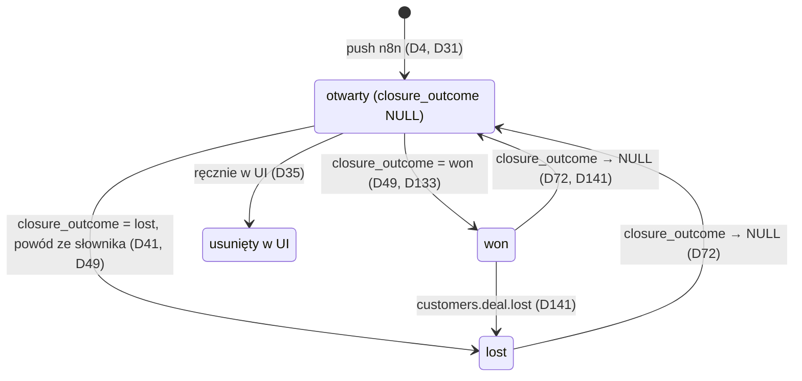
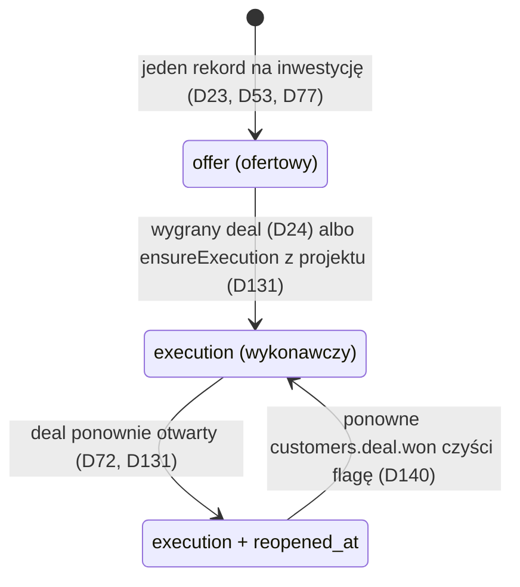
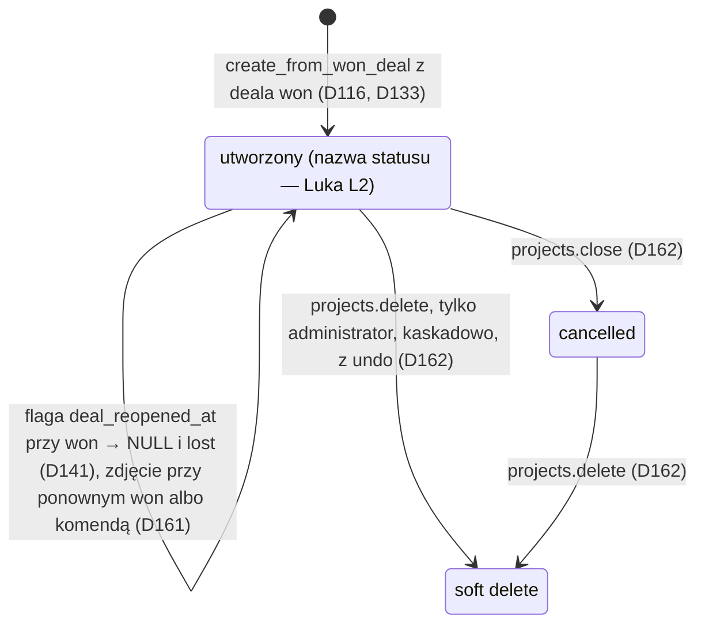
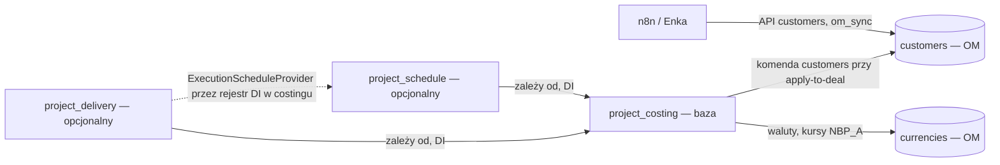

# Klin #1 — kręgosłup architektury

**Status:** 2026-10-31 (P16). Krótki przegląd: kto jest właścicielem jakiego bytu, jakie są przejścia stanów, granice modułów i klucze. Każde zdanie wskazuje decyzję D z `.ai/decisions.md`; czego nie da się wyprowadzić z D, jest oznaczone jako **Luka** (sekcja 5). Ten plik niczego nie rozstrzyga — przy rozbieżności obowiązuje rejestr (P12).

## 1. Właściciele bytów

| Byt | Moduł-właściciel | Kto tworzy | Kto może zmieniać | Źródło |
|---|---|---|---|---|
| Deal | `customers` (moduł OM, bez zmian w `packages/core`) | n8n (push przetargu do lejka „Przetargi”, score ≥ 50) | n8n tylko pola przetargowe i automatyczne etapy; wartość deala — apply-to-deal jawną komendą `customers` | D4, D31, D34, D40, D45, D66, D81 |
| Rola oferty (primary/alternative) | `project_costing` (`pc_deal_offer_roles`) | pierwsza oferta na inwestycji = primary | użytkownik (wskazanie głównej) | D5, D51, D64, D65 |
| Kalkulacja i wersja oferty | `project_costing` | użytkownik; może istnieć bez deala | użytkownik | D10, D18, D59 |
| Inwestycja | `project_costing` (`pc_investments`, encja kanoniczna) | handlowiec (n8n nie tworzy); w postępowaniu z częściami — jedna na część | handlowiec; merge/split od v1 | D52, D63, D83, D132 |
| Harmonogram (rekord inwestycji) i jego faza | `project_schedule` (opcjonalny) | jeden rekord na inwestycję | moduł harmonogramu; faza projektu przez kontrakt `ExecutionScheduleProvider` | D19, D23, D53, D77, D131 |
| Projekt realizacji | `project_delivery` (opcjonalny, prefiks `pd_`) | użytkownik jawną komendą „wygrany przetarg → realizacja” z deala `won`; n8n ani subscriber nie tworzą | użytkownik z `projects.manage`; soft delete tylko administrator | D98, D116, D133, D135, D162 |
| Dokumenty i pliki projektu | `project_delivery` (metadane w OM, pliki w S3 w UE) | użytkownik, import e-Zamówień | rewizje niemutowalne w treści; fizyczne usunięcie tylko purge administratora | D102, D103, D111, D122, D163 |
| Kursy walut | `currencies` (moduł OM) z dostawcą `NBP_A` | dostawca `NBP_A` na żądanie przy mark-sent | — (kurs ręczny tylko w drafcie kalkulacji) | D84, D85, D89 |
| Ustawienia organizacji | ModuleConfigService, klucz `org:{id}:settings` | administrator | administrator | D47, D69 |

„Faza” ma w rejestrze dwa znaczenia: faza rekordu harmonogramu (`offer` → `execution`, D77, D131) i zakres funkcji MVP/v1/v2 (np. D75). Ten plik używa pierwszego.

## 2. Przejścia stanów

### 2.1 Deal (lejek „Przetargi”, D33)

- Etapy lejka: `new`, `result_lead`, `qualify`, `contact`, `offer`, `won`, `lost`, `rejected`, `cancelled` (D33). Automat zmienia etap tylko, gdy deal stoi na `new` albo `result_lead` (D34).
- Deal usunięty w UI nie jest odtwarzany przez n8n (`last_error = 'deleted_in_om'`, D35). Wynik przetargu ustawia `winner_*`/`competitor*`; n8n nie zmienia `closure_outcome` ani powodu przegranej (D42).
- Przejścia między etapami ręcznymi i wejście do `rejected`/`cancelled` nie są opisane w D — **Luka L1**.

### 2.2 Rekord harmonogramu inwestycji (`project_schedule`, v1)

- `reopened_at` nie usuwa ani nie archiwizuje danych (D72). Dla rekordu z fazą projektu flaga leży na zadaniu fazy (`ps_schedule_tasks.execution_project_id`), nie na rekordzie (D72, D131).
- Wyłączenie modułu ukrywa dane do ponownego włączenia (D67).

### 2.3 Projekt realizacji (`project_delivery`, MVP)

- Projekt bez oferty w OM: trzy kolumny oferty i `investment_id` są NULL; ofertę podpina się później `link_winning_offer` (D116, D135).
- Pliki po soft delete zostają w S3 i liczą się do quota; fizycznie usuwa je tylko purge (D122, D126, D162).
- Nazwa statusu po utworzeniu i pozostałe statusy zamknięcia nie są w D — **Luka L2**.

### 2.4 Inwestycja

Rejestr nie definiuje stanów inwestycji; od v1 są merge i split (D83) — **Luka L3**.

## 3. Granice modułów

- Własne moduły to moduły aplikacji w forku (`apps/mercato/src/modules`), bez zmian w `packages/core` (D45).
- `project_costing` jest bazą i nie zna modułów opcjonalnych; `project_schedule` i `project_delivery` zależą od costingu i nie importują się nawzajem — współpraca tylko przez rejestr DI w costingu (D98).
- Między modułami tylko DI i eventy, zero HTTP (D100). Kalkulacja działa bez harmonogramu przez `ScheduleSource` albo import (D20).
- Tabele `pd_*` nie mają relacji ORM ani FK do `pc_*`, `ps_*`, `customers_*`; powiązania to FK-id + snapshot (D134). `execution_project_id` w harmonogramie to FK-id bez FK między modułami (D131).
- Nie włączamy `sales`, `catalog` ani `@dainamite/cpq` (D18, D90).
- Moduł harmonogramu włączany per organizacja w `module_configs` + feature'y ACL; `feature_toggles` tylko jako globalny kill-switch per tenant (D47).
- Moduł `crm_followups` jest w PR #33 (D170+ w PR #33, czeka na Q-FU); ten plik go nie opisuje do czasu merge.

## 4. Klucze i unikalność

| Co | Klucz | Źródło |
|---|---|---|
| Deal przetargu bez części | `tender_id` — jeden deal na postępowanie; kolejne ogłoszenia aktualizują deal i dodają interakcję | D31 |
| Deal części przetargu | postępowanie + część — jeden deal i jedna inwestycja na część; kontrakt push z tym kluczem na etapie kodu (zadanie Enki), do tego czasu klucz bez zmian | D31, D32, D132 |
| Idempotencja push n8n | tabela `om_sync` + hash payloadu (OM nie ma upsertu po zewnętrznym ID) | D32 |
| Grupa części jednego postępowania | `pc_investments.tender_notice_number` — tylko indeks, bez unikalności i bez udziału w dopasowaniu | D132 |
| Kod inwestycji | priorytet: e-Zamówienia → TED → BIP → `INV-YYYY-NNNNNN`; podobieństwo nazwy tylko podpowiedź | D6, D62 |
| Identyfikator części (v1) | `pc_investment_identifiers`: `source = 'bzp_notice_part'`, `value = '{numer ogłoszenia}#{numer części}'`, unikalność `(source, value)` | D132 |
| Oferta główna | jedna `primary` na inwestycję (czyli na część) | D5, D51, D65, D132 |
| Projekt | partial unique per deal i per inwestycja (`WHERE deleted_at IS NULL`, inwestycja `IS NOT NULL`); drugi → 409 `PROJECT_EXISTS` | D116 |
| Harmonogram | jeden rekord na inwestycję, jedno zadanie fazy projektu na rekord | D23, D53, D77, D131 |
| Członek projektu | unique `(project_id, user_id)`, jedna rola | D159 |
| Klucz obiektu S3 | generuje serwer: `{prefix}/org_{orgId}/tenant_{tenantId}/proj_{projectId}/{random}` | D144 |
| Ustawienia organizacji | `org:{id}:settings` w ModuleConfigService | D69 |

## 5. Luki (nie wynikają z żadnej D — nie wymyślamy)

| # | Luka | Najbliższe D | Kto rozstrzyga |
|---|---|---|---|
| L1 | Dozwolone przejścia między etapami lejka poza automatem (`qualify`, `contact`, `offer`) i wejście do `rejected`/`cancelled`. | D33, D34 | Koordynator (technicznie) albo Marek, jeśli to reguła biznesowa |
| L2 | Pełna lista statusów projektu (poza `cancelled` z `projects.close`) i ich przejścia. | D162 | Cezar (speka `project_delivery` §3 → D) |
| L3 | Stany inwestycji (np. po merge/split) i co dzieje się z ofertami, projektem i harmonogramem po merge. | D83, D116, D131 | Cezar / Koordynator przed v1 |
| L4 | Skutek usunięcia deala, który ma projekt albo harmonogram wykonawczy (D35 dotyczy tylko odtwarzania przez n8n, D141 — tylko ponownego otwarcia i `lost`). | D35, D141 | Cezar |
| L5 | Dokładny format klucza push „postępowanie + część” i jego mapowanie na `tender_id` / `om_sync`. | D31, D32 | Enka, na etapie kodu (D32) |
| L6 | Właściciel (użytkownik) deala i inwestycji — kto „ma” deal po stronie handlowca; rejestr na `develop_OM_CRM` tego nie mówi. | — | Marek przez Koordynatora (biznes) |
