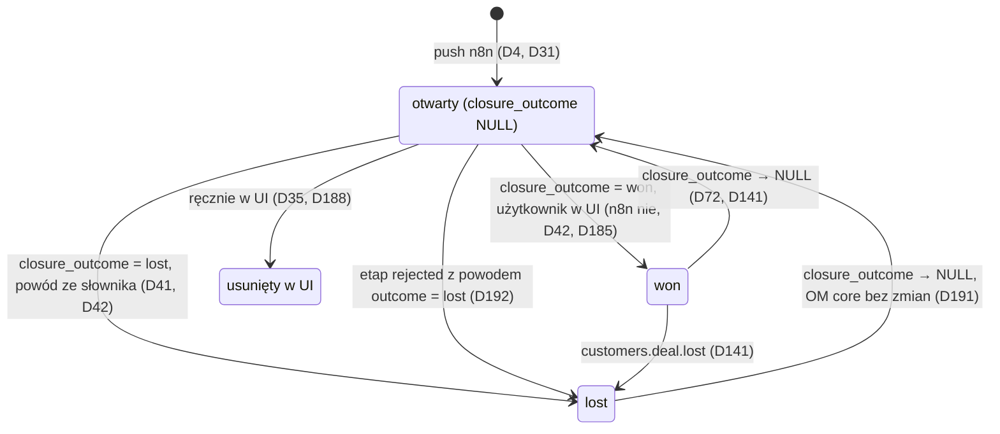
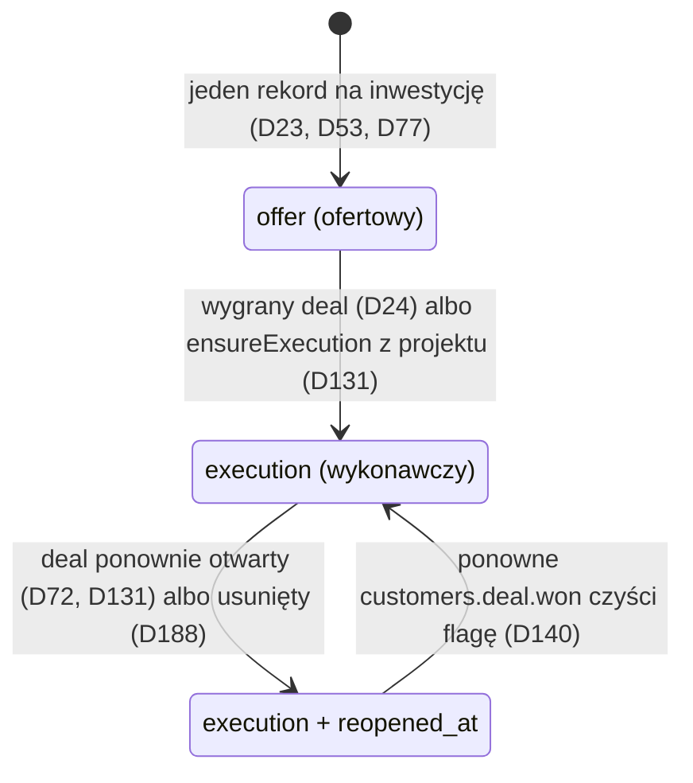
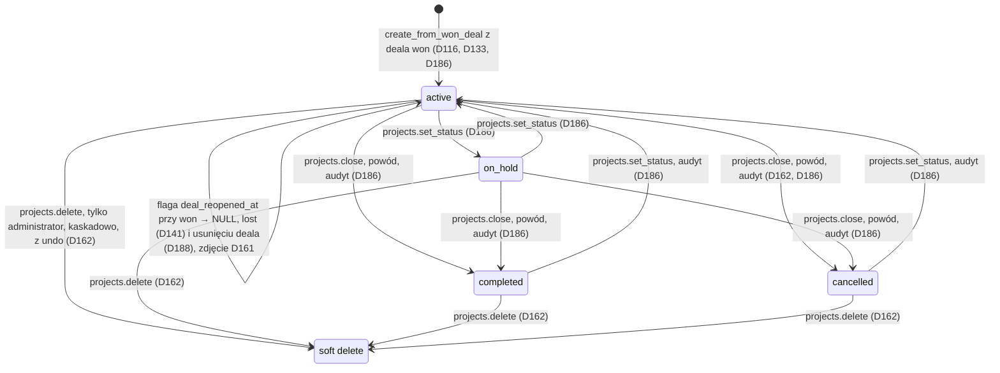
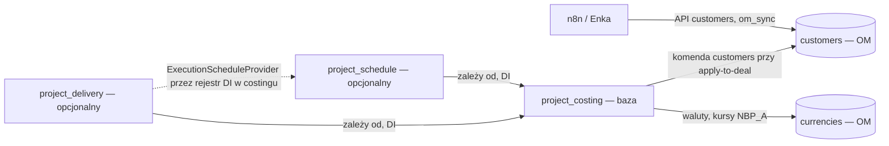

# Klin #1 — kręgosłup architektury

**Status:** 2026-10-31 (P16; luki L1–L6 przeniesione do D185–D190, `lost → open` — D191, nity po merge #35; Q-ARCH-1 → D192, Q-ARCH-2 → D193; punkty zapisu D192 rozstrzygnięte 2026-10-31 przez Cezara; otwarte tylko skutki merge z L3). Krótki przegląd: kto jest właścicielem jakiego bytu, jakie są przejścia stanów, granice modułów i klucze. Każde zdanie wskazuje decyzję D z `.ai/decisions.md`; czego nie da się wyprowadzić z D, jest oznaczone jako **Luka** (sekcja 5). Ten plik niczego nie rozstrzyga — przy rozbieżności obowiązuje rejestr (P12).

## 1. Właściciele bytów

| Byt | Moduł-właściciel | Kto tworzy | Kto może zmieniać | Źródło |
|---|---|---|---|---|
| Deal | `customers` (moduł OM, bez zmian w `packages/core`) | n8n (push przetargu do lejka „Przetargi”, score ≥ 50) | n8n tylko pola przetargowe i automatyczne etapy; wartość deala — apply-to-deal jawną komendą `customers` | D4, D31, D34, D40, D45, D66, D81 |
| Rola oferty (primary/alternative) | `project_costing` (`pc_deal_offer_roles`) | pierwsza oferta na inwestycji = primary | użytkownik (wskazanie głównej) | D5, D51, D64, D65 |
| Kalkulacja i wersja oferty | `project_costing` | użytkownik; może istnieć bez deala | użytkownik | D10, D18, D59 |
| Inwestycja | `project_costing` (`pc_investments`, encja kanoniczna) | handlowiec (n8n nie tworzy); w postępowaniu z częściami — jedna na część | handlowiec; split od v1 (D83); merge — tylko speka costing §2.2/§3.12, status `merged` od v1 (D187), skutki merge — Luka L3; właściciel = `created_by` (D190) | D52, D63, D83, D132, D187, D190 |
| Harmonogram (rekord inwestycji) i jego faza | `project_schedule` (opcjonalny) | jeden rekord na inwestycję | moduł harmonogramu; faza projektu przez kontrakt `ExecutionScheduleProvider` | D19, D23, D53, D77, D131 |
| Projekt realizacji | `project_delivery` (opcjonalny, prefiks `pd_`) | użytkownik jawną komendą „wygrany przetarg → realizacja” z deala `won`; n8n ani subscriber nie tworzą | użytkownik z `projects.manage`; soft delete tylko administrator | D98, D116, D133, D135, D162 |
| Dokumenty i pliki projektu | `project_delivery` (metadane w OM, pliki w S3 w UE) | użytkownik, import e-Zamówień (zakres MVP — D106; kolejka OM, worker — D115) | rewizje niemutowalne w treści; fizyczne usunięcie tylko purge administratora | D102, D103, D111, D122, D163 |
| Kursy walut | `currencies` (moduł OM) z dostawcą `NBP_A` | dostawca `NBP_A` na żądanie przy mark-sent | — (kurs ręczny tylko w drafcie kalkulacji) | D84, D85, D89 |
| Ustawienia organizacji | ModuleConfigService, klucz `org:{id}:settings` | administrator | administrator | D47, D69 |

„Faza” ma w rejestrze dwa znaczenia: faza rekordu harmonogramu (`offer` → `execution`, D77, D131) i zakres funkcji MVP/v1/v2 (np. D75). Ten plik używa pierwszego.

## 2. Przejścia stanów

### 2.1 Deal (lejek „Przetargi”, D33)

- Etapy lejka: `new`, `result_lead`, `qualify`, `contact`, `offer`, `won`, `lost`, `rejected`, `cancelled` (D33). Automat zmienia etap tylko, gdy deal stoi na `new` albo `result_lead` (D34).
- Deal usunięty w UI nie jest odtwarzany przez n8n (`last_error = 'deleted_in_om'`, D35). Wynik przetargu ustawia `winner_*`/`competitor*`; n8n nie zmienia `closure_outcome` ani powodu przegranej (D42).
- Źródła przejść: n8n tworzy deal i przestawia etap tylko na `result_lead` i `cancelled`, bez `closure_outcome` (D4, D31, D34, D42, D185); `won`/`lost` ustawia użytkownik w UI OM (D41 — słownik powodów odblokowuje „Oznacz jako przegrany”); D133 wymaga `won` do utworzenia projektu, D49 (marża) i D141 (flaga projektu) to skutki przejść, nie ich źródło.
- `lost → open` to zachowanie OM core bez zmian w forku; deal wraca do prognozy, moduły własne nie dodają reakcji — flagi D72 i D141 dotyczą deala po `won` (D191).
- Ręczne zmiany etapu nie wpływają na kosztorys — costing patrzy tylko na `closure_outcome` i `deleted_at` (D185). Etap `rejected` = każde odrzucenie, z powodem ze słownika `sales.deal_loss_reason` (D41; `loss_reason_id`, brak → 422 `REASON_REQUIRED`); `outcome` powodu z tabeli mapującej w module forka (seed: 9 wpisów `lost`, 3 `no_result`; nowy wpis bez mapowania = `no_result`), stosowany tylko przy etapie `rejected`: `lost` → `closure_outcome = lost`, `no_result` → `closure_outcome` zostaje NULL; „Oznacz jako przegrany” zawsze daje `lost`; prognoza kosztorysu wyklucza `rejected` niezależnie od `closure_outcome` (D185, D191, D192).
- Usunięcie deala z projektem albo harmonogramem: bez kaskady, flagi `deal_reopened_at` / `reopened_at` zostają jako historia, dane zostają; przywrócenie deala emituje `deal_restored`, flagę zdejmuje użytkownik z audytem — w projekcie z powodem (D161), w harmonogramie bez powodu, bez `project_schedule.edit` → `403 FORBIDDEN` (D188).

### 2.2 Rekord harmonogramu inwestycji (`project_schedule`, v1)

- `reopened_at` nie usuwa ani nie archiwizuje danych (D72). Dla rekordu z fazą projektu flaga leży na zadaniu fazy (`ps_schedule_tasks.execution_project_id`), nie na rekordzie (D72, D131).
- Wyłączenie modułu ukrywa dane do ponownego włączenia (D67).

### 2.3 Projekt realizacji (`project_delivery`, MVP)

- Projekt bez oferty w OM: trzy kolumny oferty i `investment_id` są NULL; ofertę podpina się później `link_winning_offer` (D116, D135).
- Pliki po soft delete zostają w S3 i liczą się do quota; fizycznie usuwa je tylko purge (D122, D126, D162).
- Statusy i przejścia: D186 (dawna Luka L2). `set_status` bez powodu; `close` z powodem i wpisem w `audit_logs`; przejście spoza listy i archiwizacja (v2) z innego statusu niż `completed`/`cancelled` → 422 `INVALID_STATUS_TRANSITION` (D186). Soft delete z każdego statusu tylko administrator (D162).

### 2.4 Inwestycja

Status domyślny `active`; `archived` w MVP (tylko odczyt, ukryta w listach, bez nowych deali — 422 `INVESTMENT_ARCHIVED`, archiwizacja i przywrócenie z `project_costing.manage_investments` i audytem, bez feature'a → 403 `FORBIDDEN`; CHECK na `status`), `merged` z `merged_into_id` od v1 (D187). Split od v1 (D83). Skutki merge dla ofert, projektu i harmonogramu — **Luka L3** (do decyzji przed v1); po tej decyzji TC-DEAL-009 (scalanie) wymaga przeglądu. Właściciel inwestycji = `created_by` (D190).

## 3. Granice modułów

- Własne moduły to moduły aplikacji w forku (`apps/mercato/src/modules`), bez zmian w `packages/core` (D45).
- `project_costing` jest bazą i nie zna modułów opcjonalnych; `project_schedule` i `project_delivery` zależą od costingu i nie importują się nawzajem — współpraca tylko przez rejestr DI w costingu (D98).
- Między modułami tylko DI i eventy, zero HTTP (D100). Kalkulacja działa bez harmonogramu przez `ScheduleSource` albo import (D20).
- Tabele `pd_*` nie mają relacji ORM ani FK do `pc_*`, `ps_*`, `customers_*`; powiązania to FK-id + snapshot (D134). `execution_project_id` w harmonogramie to FK-id bez FK między modułami (D131).
- Nie włączamy `sales`, `catalog` ani `@dainamite/cpq` (D18, D90).
- Moduł harmonogramu włączany per organizacja w `module_configs` + feature'y ACL; `feature_toggles` tylko jako globalny kill-switch per tenant (D47).
- Moduł `crm_followups` jest w PR #33 (D170+ w PR #33, czeka na Q-FU); ten plik go nie opisuje do czasu merge.

## 4. Klucze i unikalność

| Co | Klucz | Źródło |
|---|---|---|
| Deal przetargu bez części | `tender_id` — jeden deal na postępowanie; kolejne ogłoszenia aktualizują deal i dodają interakcję | D31 |
| Deal części przetargu | `ezamowienia:<tender_id>#<nr części>` — jeden deal i jedna inwestycja na część; klucze bez części bez zmian (`ezamowienia:<tender_id>`, przyjęty w D189); wdrożenie u Enki na etapie kodu, do tego czasu klucz bez zmian | D31, D32, D132, D189 |
| Idempotencja push n8n | tabela `om_sync` + hash payloadu (OM nie ma upsertu po zewnętrznym ID) | D32 |
| Grupa części jednego postępowania | `pc_investments.tender_notice_number` — tylko indeks, bez unikalności i bez udziału w dopasowaniu | D132 |
| Kod inwestycji | priorytet: e-Zamówienia → TED → BIP → `INV-YYYY-NNNNNN`; podobieństwo nazwy tylko podpowiedź | D6, D62 |
| Identyfikator części (v1) | `pc_investment_identifiers`: `source = 'bzp_notice_part'`, `value = '{numer ogłoszenia}#{numer części}'`, unikalność `(source, value)` | D132 |
| Oferta główna | jedna `primary` na inwestycję (czyli na część) | D5, D51, D65, D132 |
| Projekt | partial unique per deal i per inwestycja (`WHERE deleted_at IS NULL`, inwestycja `IS NOT NULL`); drugi → 409 `PROJECT_EXISTS` | D116 |
| Harmonogram | jeden rekord na inwestycję, jedno zadanie fazy projektu na rekord | D23, D53, D77, D131 |
| Członek projektu | unique `(project_id, user_id)`, jedna rola | D159 |
| Klucz obiektu S3 | generuje serwer: `{prefix}/org_{orgId}/tenant_{tenantId}/proj_{projectId}/{random}` | D144 |
| Ustawienia organizacji | `org:{id}:settings` w ModuleConfigService | D69 |

## 5. Luki i pytania otwarte

Luki L1, L2, L4, L5, L6 i statusy z L3 są rozstrzygnięte w rejestrze — wiersz zostaje jako odesłanie. Q-ARCH-1 i Q-ARCH-2 zamknięte (D192, D193). Otwarte są tylko skutki merge (L3); punkty zapisu D192 rozstrzygnięte (Cezar 2026-10-31); spójność D192 z D41 i speką kosztorysu rozstrzygnięta w rev 4c (seed bez duplikatów, `rejected` poza prognozą w specy kosztorysu rev 8s); pozostałe punkty D192 — sekcja „Otwarte” w `.ai/decisions.md`.

| # | Luka | Stan / odesłanie | Kto rozstrzyga |
|---|---|---|---|
| L1 | Przejścia między etapami lejka poza automatem i wejście do `rejected`/`cancelled`. | → **D185** (n8n tylko `result_lead` i `cancelled`; ręczne zmiany etapu bez wpływu na kosztorys); `lost → open` → **D191** (OM core bez zmian). znaczenie `rejected` → **D192** (każde odrzucenie, powód obowiązkowy ze słownika `sales.deal_loss_reason`, `outcome` z tabeli mapującej forka, `no_result` → `closure_outcome` NULL, prognoza bez `rejected`; punkty zapisu rozstrzygnięte przez Cezara 2026-10-31). | — |
| L2 | Statusy projektu i ich przejścia. | → **D186** | — |
| L3 | Stany inwestycji i skutki merge. | statusy → **D187**. **Otwarte:** co dzieje się z ofertami (primary, D51, D65), projektem (D116) i harmonogramem (D23) po merge; po decyzji przegląd TC-DEAL-009 (D187). | Cezar / Koordynator przed v1 |
| L4 | Skutek usunięcia deala, który ma projekt albo harmonogram wykonawczy. | → **D188** | — |
| L5 | Format klucza push „postępowanie + część”. | → **D189** (klucz bez części `ezamowienia:<tender_id>` przyjęty — brak formatu w repo; wdrożenie: Enka, etap kodu, D32) | Enka: potwierdzenie formatu bez części przy kodzie kontraktu push |
| L6 | Właściciel deala i inwestycji. | inwestycja → **D190** (`created_by`, przy kluczu API — użytkownik klucza albo NULL i administratorzy). deal z n8n → **D193** (ustawienie `crm.n8n_default_deal_owner_user_id`, domyślnie brak → szkice do administratorów). Zakres „szkiców” z D190 — D179 i D173 (`crm_followups` nie tworzy szkiców dla inwestycji). | — |

| # | Pytanie do Marka (wyłącznie przez Koordynatora) | Warianty |
|---|---|---|
| Q-ARCH-1 (zamknięte → D192) | Co znaczy etap `rejected` w lejku „Przetargi”? | (a) zamawiający odrzucił naszą ofertę → `closure_outcome = lost` z powodem (D41); (b) my rezygnujemy → etap bez `closure_outcome`; (c) usunąć etap, zostaje `lost` + powód. |
| Q-ARCH-2 (zamknięte → D193) | Kto jest właścicielem deala z przetargu (n8n)? | (a) handlowiec ustawia `owner_user_id` przy kwalifikacji, do tego czasu bez właściciela; (b) n8n przypisuje domyślnego użytkownika organizacji; (c) przydział automatyczny wg reguły (v1). |
