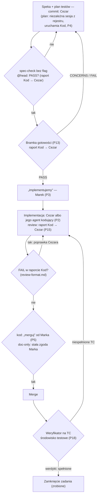
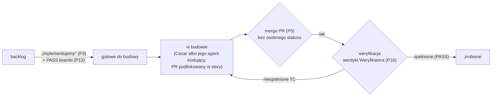

# Przepływ pracy Klin #1 (od speki do merge)

**Status:** 2026-10-31 (P18; praca w ClickUp — P22; zmiana 2026-10-31: „zrobione” dopiero po merge PR i PASS Weryfikatora; subtaski — budujący story, statusy „otwarte”/„zamknięte”; kolejność merge → werdykt Weryfikatora → zamknięcie; role Cezar / Kod / Weryfikator — P23; zmiana 2026-10-31: Kod tylko obserwator — raportuje Cezarowi, wszystkie zmiany w repo commituje Cezar; kto merguje — P23 (6)). Opis kolejności kroków i ról. Szczegóły kroków: bramka — `readiness-gate.md` (P13), review — `review-format.md` (P15), zasady agentów — `../agent-rules.md` (P17). Źródło decyzji: `.ai/decisions.md` (P12).

## Role (P23)

- **Cezar** — orkiestrator na własnym VPS (`open-mercato/cezar`): dobiera model, skille i agentów kodujących zgodnie z założeniami projektu; planuje, tnie na story i buduje (sam albo przez swojego agenta kodującego). Jest jedynym autorem zmian w repo: speki, plany testów, decyzje i kod (przez swoich agentów kodujących); commituje, otwiera PR i merguje PR doc-only (zmiana 2026-10-31).
- **Kod** — niezależny obserwator wobec Cezara: uruchamia osobne sesje do planu TC (P4: niezależna, czyta wyłącznie `.ai/decisions.md`), spec-checku, review w 3 grupach (P15) i bramki gotowości (P13), a ich wynik przekazuje w raporcie Cezarowi. Nie commituje, nie otwiera PR i nie edytuje plików w repo; nie buduje story, które sam weryfikuje. Werdykt FAIL w raporcie Kod blokuje merge, dopóki Cezar go nie poprawi; kiedy review daje FAIL — `review-format.md`, „Werdykt review” (zmiana 2026-10-31).
- **Weryfikator** — QA na środowisku testowym po merge (P18).

Spory rozstrzyga Koordynator; pytania biznesowe idą do Marka przez Koordynatora (P1, P15).

Plan TC (P4, P23 (5)): sesję planu — niezależną, czytającą wyłącznie `.ai/decisions.md` — uruchamia Kod; Cezar commituje jej wynik bez zmiany treści TC, sam robi tylko zmiany meta (P21).

Źródło: Marek 2026-10-31 (via Koordynator) (zmiana 2026-10-31; Kod jako obserwator — zmiana 2026-10-31).

## Przepływ

| # | Krok | Kto | Wejście | Wyjście |
|---|---|---|---|---|
| 1 | Speka i plan testów | Cezar (speka; commit obu plików); plan: niezależna sesja innym modelem, wyłącznie z rejestru D, bez czytania speki — uruchamia ją Kod, Cezar commituje jej wynik bez zmiany treści TC (P4, P21, P23 (5); zmiana 2026-10-31) | speka: `.ai/decisions.md` + brief (P14); plan: wyłącznie `.ai/decisions.md`, bez speki i briefów (P4) | speka + plan testów w PR doc-only |
| 2 | spec-check | Kod (osobna sesja; raport do Cezara) | pliki z repo przy SHA heada (`git show`) | raport: PASS, 0 FAIL bez flag |
| 3 | Bramka gotowości | osobna sesja tylko do odczytu, uruchomiona przez Kod; raport do Cezara | speka, plan, rejestr, brief, `architecture.md` | PASS / CONCERNS / FAIL (P13) |
| 4 | „implementujemy” | Marek, przez Koordynatora | werdykt bramki PASS | zgoda na kod (P3) |
| 5 | Implementacja (kod) i review | kod: Cezar albo jego agent kodujący (P2); review: osobna sesja uruchomiona przez Kod, w 3 grupach (P15), raport do Cezara; poprawki commituje Cezar | speka, TC | PR z kodem i testami (autor: Cezar) |
| 6 | Merge | Cezar (zmiana 2026-10-31, P23 (6)): PR doc-only — po review Kod bez FAIL, w ramach stałej zgody Marka; PR z kodem — Cezar, wyłącznie po „merguj” Marka (P5) | PR po review (krok 5), bez FAIL w raporcie Kod (`review-format.md`, „Werdykt review”) | merge do `develop_OM_CRM` w forku (P6) |
| 7 | Weryfikacja na TC | Weryfikator (QA) | TC zadania + środowisko testowe (instancja testowa open-mercato.pl, P7) ze zmergowanym kodem | werdykt per TC: spełnione / niespełnione, z dowodem |
| 8 | Zamknięcie zadania (zrobione) | Koordynator | merge (krok 6) i werdykt Weryfikatora „spełnione” (krok 7) | zadanie zamknięte, story „zrobione” (P22) |

Kolejność kroków 6–8 (zmiana 2026-10-31, spójnie z P22): merge → werdykt Weryfikatora → zamknięcie. Źródło: Marek 2026-10-31 (via Koordynator).

Warunki kolejności (P18, zmiana 2026-10-31; źródło: Marek 2026-10-31 (via Koordynator)):

1. Merge kodu do `develop_OM_CRM` nadal tylko po „merguj” od Marka (P5). Wdrożenie na produkcję dopiero po PASS Weryfikatora dla wszystkich story z danej paczki. PR doc-only merguje Cezar po review Kod bez FAIL, w ramach stałej zgody Marka; PR z kodem merguje Cezar po „merguj”; wdrożenie na produkcję tylko za zgodą Marka — wykonuje je Dawid (Dokploy) albo Mirek, nie Cezar (P23 (6), zmiana 2026-10-31).
2. Przy FAIL poprawka albo revert idzie kolejnym PR i nic z tej zmiany nie trafia na produkcję.

## Weryfikator (QA)

- Działa od „implementujemy”: dla każdego zadania sprawdza na środowisku testowym, czy spełnia swoje TC; zadanie zamykamy dopiero po jego werdykcie (P18).
- Dowód werdyktu wg P7: wynik testów i zrzuty ekranu albo przebieg na instancji testowej.
- Nie wdraża, nie merguje i nie ma dostępu do produkcji (P18). Niespełnione TC wracają do kroku 5 z listą TC i dowodem (poprawka kolejnym PR, bo kod jest już zmergowany — kroki 6–8).
- Brak TC dla zachowania albo TC sprzeczne z D → ustalenie „Do poprawy” dla niezależnej sesji planu (treść TC zmienia tylko ona, `agent-rules.md` Z11); pytanie biznesowe → „Do decyzji człowieka”, przez Koordynatora (P1, P15).
- PR doc-only (bez kodu) nie wymaga Weryfikatora: kontrolą jest spec-check bez flag @head.

## Praca w ClickUp (P22)

- Układ: Epik > Story > Subtask. Epiki: kosztorys, harmonogram, projekty i dokumentacja, follow-upy v2. Tablicę prowadzi Organizator.
- Cezar dzieli brief (5 pól, P14) na epik i tnie go na story. Story: kryteria akceptacji, numery D i TC, wersja (MVP / v1 / v2); na tyle małe, żeby Cezar albo jego agent kodujący zbudował je w jednej świeżej sesji (zmiana 2026-10-31, P23). Bez estymat w dniach (P11).
- GitHub zostaje na kod i PR-y; każde story linkuje swój PR.
- Story przechodzi do „zrobione” dopiero po merge PR (P5) i werdykcie PASS Weryfikatora („spełnione”, P18). Merge nie dostaje osobnego statusu: kolejność to merge PR → werdykt Weryfikatora → „zrobione”; do merge story zostaje w „w budowie”, po merge przechodzi do „weryfikacja”, a niespełnione TC wracają do „w budowie” (zmiana 2026-10-31; kolejność — Marek 2026-10-31 (via Koordynator)). Merge tylko po „merguj” od Marka; produkcja dopiero po PASS Weryfikatora dla wszystkich story z paczki; przy FAIL poprawka albo revert kolejnym PR, bez wdrożenia na produkcję (P18, warunki (1)–(2)).
- Speki, plany testów i PR doc-only nie wymagają story (`agent-rules.md` Z13).
- Subtaski zakłada budujący story (Cezar albo jego agent kodujący) jako kroki w ramach story; Kod niczego na tablicy ani w repo nie zakłada — wynik kontroli przekazuje w raporcie Cezarowi (zmiana 2026-10-31, P23). Jedyne statusy subtasków: „otwarte” i „zamknięte” (zmiana 2026-10-31; statusy — Koordynator 2026-10-31 (proces, Z7); kto zakłada — Marek 2026-10-31 (via Koordynator), P23).

| Status | Wejście do statusu | Kroki przepływu powyżej |
|---|---|---|
| backlog | story wycięte z epiku (P22) | 1–3 |
| gotowe do budowy | „implementujemy” i PASS bramki gotowości (P3, P13) | 4 |
| w budowie | Cezar albo jego agent kodujący buduje story; PR podlinkowany w story; story zostaje tu do merge PR | 5–6 |
| weryfikacja | PR zmergowany (P5); Weryfikator sprawdza TC | 7 (P18) |
| zrobione | werdykt Weryfikatora PASS („spełnione”) po merge PR (P5, P18) | 8 |
