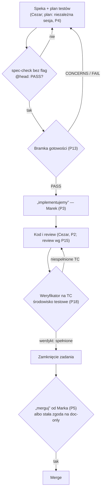
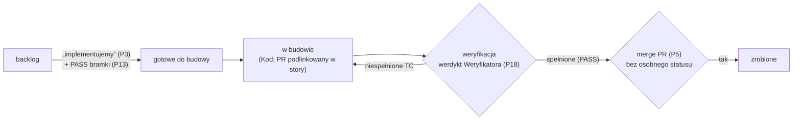

# Przepływ pracy Klin #1 (od speki do merge)

**Status:** 2026-10-31 (P18; praca w ClickUp — P22; zmiana 2026-10-31: „zrobione” dopiero po merge PR i PASS Weryfikatora; subtaski — Kod, statusy „otwarte”/„zamknięte”). Opis kolejności kroków i ról. Szczegóły kroków: bramka — `readiness-gate.md` (P13), review — `review-format.md` (P15), zasady agentów — `../agent-rules.md` (P17). Źródło decyzji: `.ai/decisions.md` (P12).

## Przepływ

| # | Krok | Kto | Wejście | Wyjście |
|---|---|---|---|---|
| 1 | Speka i plan testów | Cezar (speka); niezależna sesja innym modelem (plan, z rejestru D, bez czytania speki) | speka: `.ai/decisions.md` + brief (P14); plan: wyłącznie `.ai/decisions.md`, bez speki i briefów (P4) | speka + plan testów w PR doc-only |
| 2 | spec-check | wykonawca | pliki z repo przy SHA heada (`git show`) | PASS, 0 FAIL bez flag |
| 3 | Bramka gotowości | osobna sesja tylko do odczytu | speka, plan, rejestr, brief, `architecture.md` | PASS / CONCERNS / FAIL (P13) |
| 4 | „implementujemy” | Marek, przez Koordynatora | werdykt bramki PASS | zgoda na kod (P3) |
| 5 | Kod i review | Cezar (P2); review w formacie P15 | speka, TC | PR z kodem i testami |
| 6 | Weryfikacja na TC | Weryfikator (QA) | TC zadania + środowisko testowe (instancja testowa open-mercato.pl, P7) | werdykt per TC: spełnione / niespełnione, z dowodem |
| 7 | Zamknięcie zadania | Koordynator | werdykt Weryfikatora „spełnione” | zadanie zamknięte |
| 8 | Merge | wykonawca, dopiero po „merguj” Marka albo w ramach stałej zgody na PR doc-only (P5) | zamknięte zadanie, draft PR | merge do `develop_OM_CRM` w forku (P6) |

## Weryfikator (QA)

- Działa od „implementujemy”: dla każdego zadania sprawdza na środowisku testowym, czy spełnia swoje TC; zadanie zamykamy dopiero po jego werdykcie (P18).
- Dowód werdyktu wg P7: wynik testów i zrzuty ekranu albo przebieg na instancji testowej.
- Nie wdraża, nie merguje i nie ma dostępu do produkcji (P18). Niespełnione TC wracają do kroku 5 z listą TC i dowodem.
- Brak TC dla zachowania albo TC sprzeczne z D → ustalenie „Do poprawy” dla niezależnej sesji planu (treść TC zmienia tylko ona, `agent-rules.md` Z11); pytanie biznesowe → „Do decyzji człowieka”, przez Koordynatora (P1, P15).
- PR doc-only (bez kodu) nie wymaga Weryfikatora: kontrolą jest spec-check bez flag @head.

## Praca w ClickUp (P22)

- Układ: Epik > Story > Subtask. Epiki: kosztorys, harmonogram, projekty i dokumentacja, follow-upy v2. Tablicę prowadzi Organizator.
- Cezar dzieli brief (5 pól, P14) na epik i tnie go na story. Story: kryteria akceptacji, numery D i TC, wersja (MVP / v1 / v2); na tyle małe, żeby Kod zbudował je w jednej świeżej sesji. Bez estymat w dniach (P11).
- GitHub zostaje na kod i PR-y; każde story linkuje swój PR.
- Story przechodzi do „zrobione” dopiero po merge PR (P5) i werdykcie PASS Weryfikatora („spełnione”, P18). Merge nie dostaje osobnego statusu: story z werdyktem PASS i niezmergowanym PR zostaje w „weryfikacja” do merge (zmiana 2026-10-31).
- Speki, plany testów i PR doc-only nie wymagają story (`agent-rules.md` Z13).
- Subtaski zakłada sam Kod jako kroki w ramach story. Jedyne statusy subtasków: „otwarte” i „zamknięte” (zmiana 2026-10-31; źródło: Koordynator 2026-10-31 (proces, Z7)).

| Status | Wejście do statusu | Kroki przepływu powyżej |
|---|---|---|
| backlog | story wycięte z epiku (P22) | 1–3 |
| gotowe do budowy | „implementujemy” i PASS bramki gotowości (P3, P13) | 4 |
| w budowie | Kod buduje story; PR podlinkowany w story | 5 |
| weryfikacja | PR gotowy do sprawdzenia na TC; story zostaje tu po PASS do merge PR | 6–7 (P18) |
| zrobione | werdykt Weryfikatora PASS („spełnione”) i merge PR (P5, P18) | 8 |
