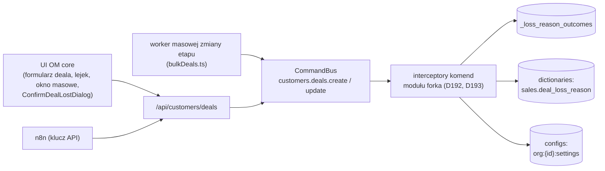

# Spec: Powody odrzucenia deala i opiekun deala z n8n — realizacja D192 i D193

<!-- Source doc: .ai/specs/2026-10-31-deal-loss-reasons-n8n-owner.md -->

| Pole | Wartość |
|------|---------|
| **Status** | draft |
| **Data** | 2026-10-31 |
| **Rewizja** | 2026-10-31 (rev 1 — pierwsza wersja, doc-PR po #33) |
| **Faza** | MVP (D192, D193) |
| **Moduł** | moduł aplikacji forka w `apps/mercato/src/modules/<moduł>` (D45); nazwa modułu i prefiks tabel — etap kodu (D192), propozycja w Q-LR-6 |
| **Zależności upstream** | `customers` (komendy `customers.deals.create` / `customers.deals.update`, worker masowej zmiany etapu), `dictionaries` (słownik `sales.deal_loss_reason`), `configs` (ModuleConfigService, `org:{id}:settings`, D69), `auth` / `directory` (użytkownicy, scope), `api_keys`, kontrakt interceptorów komend (`@open-mercato/shared/lib/commands/command-interceptor`) |
| **Wyłączone upstream** | zmiany w `packages/core` (D45); osobny słownik odrzuceń (D192); automatyczne reguły przydziału opiekuna (D193) |
| **Kod bazowy rozpoznania** | `develop_OM_CRM` @ `41549820a198aea08a0ab9f36271a704439889cd` (linki w §1 to permalinki do tego SHA) |
| **Etap** | tylko specyfikacja; kod po „implementujemy” (P3) |

## TLDR

- Jeden moduł aplikacji forka (D45) realizuje dwie decyzje: D192 (etap `rejected` z obowiązkowym powodem ze słownika `sales.deal_loss_reason` i tabelą mapującą `outcome`) i D193 (domyślny opiekun deala tworzonego przez push n8n).
- Reguły pilnują interceptory komend `customers.deals.create` i `customers.deals.update` — jedna ścieżka zapisu dla formularza, lejka, ścieżki masowej i API, bez zmian w `packages/core`.
- Błędy: 422 `REASON_REQUIRED` (brak powodu przy `rejected` albo `closureOutcome = lost`), 422 `INVALID_LOSS_REASON` (powód spoza `lost` na ścieżce „Oznacz jako przegrany”), 422 przy zapisie złego ustawienia D193 (kod — Q-LR-1).
- Seed: 3 nowe wpisy słownika i 12 jawnych mapowań (D41, D192).
- Okno „Oznacz jako przegrany” (`ConfirmDealLostDialog`) jest w core i ładuje cały słownik; reguła działa po stronie API od razu, a filtrowanie listy w UI wymaga mechanizmu forka — warianty w §6, wybór w Q-LR-5.

## Streszczenie

Zakres: tabela mapująca `<prefiks>_loss_reason_outcomes`, seed, interceptor D192, ustawienie `crm.n8n_default_deal_owner_user_id` z walidacją i interceptor D193, okno „Oznacz jako przegrany” w forku, ACL i audyt. Poza zakresem: nowe decyzje biznesowe (wszystkie reguły pochodzą z D33, D41, D42, D45, D69, D179, D185, D191, D192, D193), metryki skuteczności (reguła na przyszłość w D192, bez TC), zmiany w n8n (D185, D42).

## 0. Architecture (Architektura)

### 0.1 Moduł i kierunek zależności

- Moduł forka zależy od `customers`, `dictionaries`, `configs` i `auth` tylko przez publiczne kontrakty (identyfikatory komend, kontrakt interceptora, ModuleConfigService). `customers` nie wie o module forka (D45).
- Plik interceptorów: `commands/interceptors.ts` modułu (wzorzec: moduł `example`, §1). Interceptor zwraca `ok: false` ze `status: 422` i `body` z kodem albo `ok: true` z `modifiedInput` (§1, l.65–79).
- Bez nowych tras API dla dealu. Nowe trasy tylko do zarządzania mapowaniem i ustawieniem (§8).

### 0.2 Komendy i zapisy (write path)

| Zapis | Mechanizm | Audyt |
|---|---|---|
| zmiana etapu / zamknięcie deala | istniejące komendy `customers.deals.*` + interceptor (§4) | log komendy core; interceptor dopisuje do metadanych `lossReasonOutcome` (§8) |
| mapowanie powodu (edycja `outcome`) | komenda modułu `<moduł>.loss_reason_outcomes.update` | wpis w `audit_logs` (stara i nowa wartość) |
| seed | idempotentny krok `setup.ts` modułu + komenda CLI dla istniejących organizacji (§3) | log seedu z liczbą dodanych wpisów |
| ustawienie D193 | ModuleConfigService (`org:{id}:settings`, D69) przez komendę modułu z walidacją (§7) | wpis w `audit_logs` |

## 1. Rozpoznanie forka (read-only, `develop_OM_CRM` @ 41549820)

| Miejsce | Co wynika |
|---|---|
| [`packages/shared/src/lib/commands/command-interceptor.ts` l.65–79](https://github.com/AdamskiMarek/open-mercato/blob/41549820a198aea08a0ab9f36271a704439889cd/packages/shared/src/lib/commands/command-interceptor.ts#L65-L79) | wynik `beforeExecute`: `ok`, `message`, `status`, `body`, `modifiedInput`, `metadata`; kontekst ma `auth` (w tym `isApiKey`) i `container` |
| [`apps/mercato/src/modules/example/commands/interceptors.ts`](https://github.com/AdamskiMarek/open-mercato/blob/41549820a198aea08a0ab9f36271a704439889cd/apps/mercato/src/modules/example/commands/interceptors.ts) | rejestracja interceptorów komend w module aplikacji (`targetCommand`, `priority`) |
| [`customers/data/validators.ts` l.186–188](https://github.com/AdamskiMarek/open-mercato/blob/41549820a198aea08a0ab9f36271a704439889cd/packages/core/src/modules/customers/data/validators.ts#L186-L188) | `closureOutcome` tylko `won` / `lost`, `lossReasonId` (uuid, opcjonalny), `lossNotes` |
| [`customers/commands/deals.ts` l.122–130](https://github.com/AdamskiMarek/open-mercato/blob/41549820a198aea08a0ab9f36271a704439889cd/packages/core/src/modules/customers/commands/deals.ts#L122-L130) | `resolveRequestedClosureOutcome`: `closureOutcome` albo wyprowadzenie ze `status` — ścieżka „lost” to także `status = lost` |
| [`customers/commands/deals.ts` l.870–887](https://github.com/AdamskiMarek/open-mercato/blob/41549820a198aea08a0ab9f36271a704439889cd/packages/core/src/modules/customers/commands/deals.ts#L870-L887) | `closureOutcome` (z `lossReasonId` / `lossNotes`) czyszczone tylko przy zmianie `status` na niezamknięty; sama zmiana etapu go nie czyści |
| [`customers/lib/bulkDeals.ts` l.47–52](https://github.com/AdamskiMarek/open-mercato/blob/41549820a198aea08a0ab9f36271a704439889cd/packages/core/src/modules/customers/lib/bulkDeals.ts#L47-L52), [l.163](https://github.com/AdamskiMarek/open-mercato/blob/41549820a198aea08a0ab9f36271a704439889cd/packages/core/src/modules/customers/lib/bulkDeals.ts#L163), [l.172–174](https://github.com/AdamskiMarek/open-mercato/blob/41549820a198aea08a0ab9f36271a704439889cd/packages/core/src/modules/customers/lib/bulkDeals.ts#L172-L174), [l.226](https://github.com/AdamskiMarek/open-mercato/blob/41549820a198aea08a0ab9f36271a704439889cd/packages/core/src/modules/customers/lib/bulkDeals.ts#L226) | masowa zmiana etapu: payload tylko `pipelineStageId`; per deal `customers.deals.update` z `{ id, pipelineStageId }`; błąd pozycji do `failedItems` (`id`, `message`), reszta przetwarzana dalej |
| [`customers/components/detail/ConfirmDealLostDialog.tsx` l.55](https://github.com/AdamskiMarek/open-mercato/blob/41549820a198aea08a0ab9f36271a704439889cd/packages/core/src/modules/customers/components/detail/ConfirmDealLostDialog.tsx#L55), [l.109](https://github.com/AdamskiMarek/open-mercato/blob/41549820a198aea08a0ab9f36271a704439889cd/packages/core/src/modules/customers/components/detail/ConfirmDealLostDialog.tsx#L109), [l.124](https://github.com/AdamskiMarek/open-mercato/blob/41549820a198aea08a0ab9f36271a704439889cd/packages/core/src/modules/customers/components/detail/ConfirmDealLostDialog.tsx#L124) | okno ładuje cały słownik `loadDictionaryEntriesByKey('sales.deal_loss_reason')`; potwierdzenie zablokowane bez powodu; `onConfirm({ lossReasonId, lossNotes })` |
| [`customers/backend/customers/deals/[id]/page.tsx` l.27, l.703](https://github.com/AdamskiMarek/open-mercato/blob/41549820a198aea08a0ab9f36271a704439889cd/packages/core/src/modules/customers/backend/customers/deals/%5Bid%5D/page.tsx#L703) | okno użyte bezpośrednio (import), bez `useRegisteredComponent` — nie da się go podmienić rejestrem komponentów |
| [`customers/backend/customers/deals/pipeline/page.tsx` l.419, l.425](https://github.com/AdamskiMarek/open-mercato/blob/41549820a198aea08a0ab9f36271a704439889cd/packages/core/src/modules/customers/backend/customers/deals/pipeline/page.tsx#L419) | `useRegisteredComponent` tylko dla QuickDealDialog i ViewTabsRow |
| [`customers/components/detail/DealForm.tsx` l.1046](https://github.com/AdamskiMarek/open-mercato/blob/41549820a198aea08a0ab9f36271a704439889cd/packages/core/src/modules/customers/components/detail/DealForm.tsx#L1046) | CrudForm z polem etapu, bez pola `lossReasonId` |
| [`dictionaries/data/entities.ts`](https://github.com/AdamskiMarek/open-mercato/blob/41549820a198aea08a0ab9f36271a704439889cd/packages/core/src/modules/dictionaries/data/entities.ts) | wpis: `value`, `normalized_value` (unikalny per słownik i scope), `label`; bez pól dodatkowych — dlatego `outcome` w tabeli forka (D192) |

Wniosek dla UI: żadna ścieżka zmiany etapu w UI core (formularz, kanban, okno masowe) nie wysyła `lossReasonId`. Po włączeniu interceptora przejście na `rejected` z tych miejsc kończy się 422 `REASON_REQUIRED` (Q-LR-5).

## 2. Model danych — `<prefiks>_loss_reason_outcomes` (D192)

| Kolumna | Typ | Uwagi |
|---|---|---|
| `id` | uuid PK | |
| `organization_id`, `tenant_id` | uuid | scope jak w `dictionaries` |
| `dictionary_entry_id` | uuid | wpis słownika `sales.deal_loss_reason` (bez FK między modułami) |
| `outcome` | text CHECK `lost \| no_result` | D192 |
| `created_at`, `updated_at`, `deleted_at` | timestamptz | konwencje encji OM (soft delete) |

- Unikalność: `(organization_id, dictionary_entry_id)` częściowo `WHERE deleted_at IS NULL` (D192).
- Brak wiersza dla wpisu = `no_result` (tylko nowe wpisy po seedzie; wpisy seedu mają wiersz jawnie, D192).
- Usunięty (soft delete) wpis słownika: mapowanie zostaje; interceptor odrzuca powód spoza aktywnych wpisów słownika (§4, kod — Q-LR-7).
- Migracja: nowa tabela modułu, bez zmian w tabelach core.

## 3. Seed (D41, D192)

Idempotentny, per organizacja; wpisy rozpoznawane po `normalized_value`, nie po UUID.

| # | Wpis słownika | Dodawany przez seed | `outcome` |
|---|---|---|---|
| 1 | `price_too_high` (D41) | nie | `lost` |
| 2 | `delivery_time` (D41) | nie | `lost` |
| 3 | `no_capacity` (D41) | nie | `lost` |
| 4 | `technical_requirements` (D41) | nie | `lost` |
| 5 | `lost_to_competitor` (D41) | nie | `lost` |
| 6 | `investment_cancelled` (D41) | nie | `lost` |
| 7 | `no_decision` (D41) | nie | `lost` |
| 8 | `payment_terms` (D41) | nie | `lost` |
| 9 | `not_bid` „Nie startowaliśmy” (D41; = „nie składamy oferty”) | nie | `no_result` |
| 10 | „Odrzucona przez zamawiającego” | tak | `lost` |
| 11 | „Nasza rezygnacja” | tak | `no_result` |
| 12 | „Inne” | tak | `no_result` |

- Wynik: słownik ma 12 wpisów, wszystkie zmapowane jawnie (D41, D192). Ponowne uruchomienie nie dodaje duplikatów ani nie nadpisuje mapowania zmienionego przez administratora.
- Brak któregoś z 9 wpisów D41 w organizacji: seed go nie tworzy (D41 jest źródłem tych wpisów), loguje ID organizacji i brakujący `value`.
- Uruchomienie: `setup.ts` modułu dla nowych organizacji i komenda CLI modułu dla istniejących. `value` trzech nowych wpisów — Q-LR-6.

## 4. Interceptor D192 — `customers.deals.create` i `customers.deals.update`

Etap `rejected` rozpoznawany po kluczu etapu lejka „Przetargi” (D33), nie po UUID. Kolejność sprawdzeń w `beforeExecute`:

1. **Przejście na `rejected`** (etap docelowy = `rejected`, a bieżący ≠ `rejected`; przy create — etap startowy `rejected`): brak `lossReasonId` → 422 `REASON_REQUIRED`. Powód spoza aktywnych wpisów `sales.deal_loss_reason` organizacji → odrzucenie 422 (kod — Q-LR-7). Powód `lost` → `modifiedInput` z `closureOutcome = lost`; powód `no_result` → bez `closureOutcome` (zostaje NULL, enum core bez zmian, D45, D192).
2. **Ścieżka „Oznacz jako przegrany”** — `closureOutcome = lost` jawnie albo wyprowadzone ze `status` (`resolveRequestedClosureOutcome`, §1): brak `lossReasonId` → 422 `REASON_REQUIRED`; powód z `outcome` innym niż `lost` (`no_result` albo bez mapowania) → 422 `INVALID_LOSS_REASON` (D192, zmiana 2026-10-31). Ta ścieżka nie zmienia etapu poza tym, co robi core (etap terminalny lejka).
3. Pozostałe aktualizacje — bez zmian.

Zakres i skutki:

- Jedna reguła dla formularza, kanbanu, API i ścieżki masowej, bo wszystkie idą przez `customers.deals.update` (D192).
- **Ścieżka masowa:** worker nie przenosi `lossReasonId` (§1), więc każdy deal przenoszony na `rejected` dostaje 422 `REASON_REQUIRED`, zapisany w `failedItems` (`id`, `message`) podsumowania joba; pozostałe deale z tej samej operacji są przetwarzane (D192, zmiana 2026-10-31). `message` zawiera kod `REASON_REQUIRED`.
- n8n nie ustawia `rejected` i nie zmienia `closure_outcome` ani powodu (D185, D42) — interceptor nie ma wyjątku dla n8n.
- Prognoza kosztorysu wyklucza `rejected` niezależnie od `closure_outcome` (D185, D191) — interceptor tego nie dotyczy.
- Poza zakresem do odpowiedzi na Q-LR-4: zmiana powodu, gdy deal już jest na `rejected`, i wyjście z `rejected` przez sam etap.

Format odpowiedzi 422: `body` jak w trasach CRUD core (`error` z kodem i komunikatem); w ścieżce masowej — `message` błędu pozycji.

## 5. Lejek i ścieżka masowa w UI

- Kanban i formularz deala w core nie mają pola powodu (§1). Do decyzji o mechanizmie UI (Q-LR-5) przejście na `rejected` z tych miejsc pokazuje błąd 422 `REASON_REQUIRED` z API (istniejąca obsługa błędów zapisu).
- Okno masowej zmiany etapu: wynik joba pokazuje liczbę błędów i `failedItems`; użytkownik przenosi deale na `rejected` pojedynczo z powodem.

## 6. Okno „Oznacz jako przegrany” (`ConfirmDealLostDialog`, D41, D192)

Stan: komponent core, ładuje cały słownik (12 wpisów po seedzie); D192 wymaga, by UI pokazywał tylko powody `lost`. Reguła działa od pierwszego dnia po stronie API (§4 pkt 2, 422 `INVALID_LOSS_REASON`). Warianty forka bez zmian w `packages/core` (D45):

| Wariant | Opis | Za | Przeciw |
|---|---|---|---|
| A. Podmiana strony szczegółów deala | rejestracja `page:` dla `/backend/customers/deals/[id]` (SPEC-041h) z kopią strony, w której okno filtruje powody po mapowaniu (endpoint modułu z listą ID powodów `lost`) | pełna zgodność z D192 w UI | kopia dużej strony core; koszt merge z upstream (D45) |
| B. Wrapper / `propsTransform` komponentu | wymaga, by okno było zarejestrowane przez `useRegisteredComponent` | mały kod | dziś niemożliwe bez zmiany core (§1, page.tsx l.703) |
| C. Tylko API + komunikat | bez zmian UI; wybór powodu `no_result` kończy się czytelnym 422 `INVALID_LOSS_REASON` | zero kodu UI | UI pokazuje powody, których nie wolno użyć (niezgodne z „UI pokazuje tylko powody `lost`”, D192) |
| D. Interceptor API listy wpisów słownika | filtrowanie `/api/dictionaries/.../entries` | — | odrzucony: lista słownika jest globalna (zarządzanie słownikiem, inne okna), filtr zepsułby edycję słownika |

Wybór — Q-LR-5. Do czasu wyboru obowiązuje wariant C jako stan przejściowy (zapis w rejestrze: sekcja „Otwarte”, D192).

## 7. D193 — ustawienie `crm.n8n_default_deal_owner_user_id`

- Miejsce: ModuleConfigService, `org:{id}:settings` (D69); domyślnie `null` (D193).
- Zapis: komenda modułu z walidacją — użytkownik aktywny i należy do organizacji; inaczej 422 (D193; kod — Q-LR-1), ustawienie bez zmian.
- Interceptor `customers.deals.create` (`modifiedInput.ownerUserId`), tylko gdy: (1) aktor to klucz API integracji n8n (rozpoznanie — Q-LR-2), (2) push nie podaje `ownerUserId`, (3) ustawienie ≠ `null`.
- W chwili importu użytkownik nieaktywny, usunięty albo poza organizacją → deal bez opiekuna, ostrzeżenie w logu (tylko ID deala i użytkownika) (D193).
- Bez interceptora na `customers.deals.update`; bez wstecznego przypisania; późniejsze pushe nie zmieniają opiekuna (D193).
- Skutek dla `crm_followups`: deal bez opiekuna → szkice do administratorów (D179).

## 8. ACL, audyt, logi

- Edycja mapowania i ustawienia D193: feature administracyjny modułu (np. `<moduł>.settings.manage`), granty domyślne tylko dla administratora; brak feature'a → `403 FORBIDDEN` (D147).
- Interceptor D192 nie dodaje uprawnień: kto może zmienić deal w core, może go przenieść na `rejected` z powodem.
- Audyt: zmiany mapowania i ustawienia w `audit_logs`; interceptor D192 dopisuje do metadanych komendy `lossReasonOutcome` (`lost` / `no_result`), bez treści.
- Logi: tylko ID (deal, wpis, użytkownik, organizacja) i kody.

## 9. Migracje i backward compatibility

- Nowa tabela modułu i seed; bez zmian schematu core.
- Istniejące deale na `rejected` bez powodu zostają (reguła działa przy przejściu); bez migracji danych.
- Włączenie modułu = włączenie reguły w całej instancji; wyłączenie modułu przywraca zachowanie core.

## 10. Risks (Ryzyka — z ryzykiem rezydualnym)

| # | Ryzyko | Skutek | Mitygacja | Rezydualne |
|---|---|---|---|---|
| R-LR-1 | UI core nie wysyła `lossReasonId` przy zmianie etapu | 422 przy każdym przejściu na `rejected` z kanbanu / formularza / masowo | komunikat 422; Q-LR-5 (mechanizm UI) | Średnie do odpowiedzi na Q-LR-5 |
| R-LR-2 | Okno „Oznacz jako przegrany” pokazuje powody `no_result` | 422 `INVALID_LOSS_REASON` po wyborze | wariant A z §6 | Niskie (reguła po stronie API) |
| R-LR-3 | Aktualizacja core zmienia identyfikatory komend albo kontrakt interceptora | interceptor przestaje działać | test kontraktu w module; przegląd przy merge upstream | Niskie |
| R-LR-4 | Zmiana powodu na `rejected` albo wyjście z `rejected` zostawia `closure_outcome` | rozjazd metryk (D192) | Q-LR-4 | Średnie |
| R-LR-5 | Błędne rozpoznanie klucza n8n | opiekun nadany dealom spoza n8n albo pominięty | Q-LR-2 | Niskie |

## 11. Pytania techniczne do Cezara (otwarte)

- **Q-LR-1 (wniosek 34 planu kosztorysu):** kod 422 walidacji ustawienia D193. Propozycja: `INVALID_SETTING_VALUE` (wspólny z Q-FU-T1 w specy `crm_followups`).
- **Q-LR-2 (wniosek 35):** po czym interceptor rozpoznaje „klucz API integracji n8n”: (a) ustawienie organizacji z ID klucza; (b) dedykowany feature klucza (np. `<moduł>.n8n_import`); (c) nazwa klucza. Kontekst interceptora ma `auth.isApiKey` i ID klucza (§1).
- **Q-LR-3 (wniosek 36):** deal na `rejected` z ofertą `primary`: czy oferta traci rolę głównej i co pokazuje widget inwestycji (D185 wyklucza `rejected` z sumy).
- **Q-LR-4 (wniosek 38, część 2; P20):** D192 „mapowanie działa tylko przy przejściu na `rejected`” vs „`closure_outcome = lost` zawsze ma powód typu `lost`”: (a) zmiana powodu na `rejected` z `lost` na `no_result` — czy przelicza `closure_outcome` (inaczej `lost` z powodem `no_result`); (b) wyjście z `rejected` samą zmianą etapu — core nie czyści `closure_outcome` (`deals.ts` l.870–887); czy interceptor ma je czyścić, czy to D191 (`lost → open` bez zmian w core).
- **Q-LR-5:** mechanizm UI: wariant okna „Oznacz jako przegrany” (§6) i sposób podania powodu przy zmianie etapu na `rejected` z formularza, kanbanu i okna masowego (np. wstrzyknięcie pola do CrudForm, własne okno modułu przed zmianą etapu).
- **Q-LR-7:** kod 422 dla `lossReasonId` spoza aktywnych wpisów `sales.deal_loss_reason` organizacji (nieistniejący, usunięty, z innej organizacji). D192 nazywa `INVALID_LOSS_REASON` tylko dla ścieżki „Oznacz jako przegrany”. Propozycja: ten sam `INVALID_LOSS_REASON` na obu ścieżkach.
- **Q-LR-6:** nazwa modułu i prefiks tabel (D192 „etap kodu”); `value` trzech nowych wpisów seedu. Propozycja: `value` w stylu D41 (`rejected_by_buyer`, `our_withdrawal`, `other`).

## 12. Uwagi dla planu testów (niezależny plan, osobna sesja)

Plan pisze niezależna sesja z rejestru (P4). Zakres nowy względem planu kosztorysu: D192 zmiana 2026-10-31 (ścieżka „lost” bez powodu → 422 `REASON_REQUIRED`; ścieżka masowa → `failedItems` z `REASON_REQUIRED`), D193 bez zmian reguł.

## 13. Final Compliance Report (vs `AGENTS.md`)

| Punkt | Stan |
|---|---|
| Bez zmian w `packages/core` (D45) | tak — interceptory, nowa tabela i UI w module aplikacji |
| Brak FK między modułami | tak — `dictionary_entry_id` bez FK |
| Scope `organization_id` / `tenant_id` | tak — tabela i seed per organizacja |
| Zapisy przez komendy z audytem | tak — §0.2, §8 |
| Kody błędów: 422 `UPPER_SNAKE`, `403 FORBIDDEN` | tak; kod D193 — Q-LR-1 |
| Bez sekretów i bez treści w logach | tak — tylko ID i kody |
| Bez estymat w dniach (P11) | tak |
| Bez nowych zależności | tak |

## 14. Decision traceability (śledzenie decyzji)

| D | Gdzie |
|---|---|
| D33 | §4 — etap `rejected` lejka „Przetargi” po kluczu |
| D41 | §3 — 9 powodów i seed bez duplikatów; §6 |
| D42 | §4 — n8n nie zmienia `closure_outcome` ani powodu |
| D45 | §0, §6, §9 — moduł forka, bez zmian w core |
| D69 | §7 — `org:{id}:settings` |
| D147 | §8 — `403 FORBIDDEN` |
| D179 | §7 — deal bez opiekuna → administratorzy |
| D185 | §4 — n8n nie ustawia `rejected`; prognoza bez `rejected` |
| D191 | §4, Q-LR-4 — `lost → open` |
| D192 | §2–§6, Q-LR-3…Q-LR-7 |
| D193 | §7, Q-LR-1, Q-LR-2 |

## Changelog

| Data | Zmiana |
|------|--------|
| 2026-10-31 | **rev 1** — pierwsza wersja (doc-PR po #33, polecenie Cezara 2026-10-31): moduł forka, tabela mapująca, seed 12 wpisów, interceptor D192 (`REASON_REQUIRED`, `INVALID_LOSS_REASON`, ścieżka masowa), okno „Oznacz jako przegrany” (warianty), ustawienie D193; pytania Q-LR-1…Q-LR-7. |
