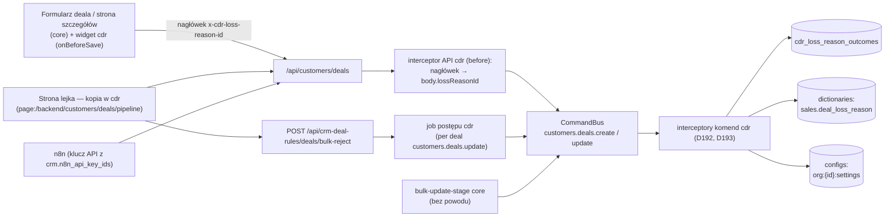

# Spec: Powody odrzucenia deala i opiekun deala z n8n — realizacja D192 i D193

<!-- Source doc: .ai/specs/2026-10-31-deal-loss-reasons-n8n-owner.md -->

| Pole | Wartość |
|------|---------|
| **Status** | draft |
| **Data** | 2026-10-31 |
| **Rewizja** | 2026-10-31 (rev 4a — meta: §13 warunek review D45 dla PR z kodem; rev 4 — czyszczenie w §4: (A) wyjście z `rejected` z powodem `no_result` — komenda modułu w `afterExecute`, (B) deal `lost` na `rejected` z `no_result` — droga pkt 2; R-LR-7 rozszerzony; rev 3 — Q-LR-8 zamknięte: przechwycenie wystarcza na MVP; Q-LR-9: walidacja `crm.n8n_api_key_ids`; D191 z wyjątkiem wyjścia z `rejected`; R-LR-7 jako warunek testu na etapie kodu; rev 2 — rozstrzygnięcia Cezara Q-LR-1…Q-LR-7: moduł `crm_deal_rules` (`cdr_`), `INVALID_SETTING_VALUE`, `crm.n8n_api_key_ids`, przeliczenie i czyszczenie przy `rejected`, `INVALID_LOSS_REASON`, własne okno powodu w UI (§6, wariant A z rev 1 skorygowany); rev 1 — pierwsza wersja, doc-PR po #33) |
| **Faza** | MVP (D192, D193); S24 gotowe dopiero z działającym UI (§6) |
| **Moduł** | `crm_deal_rules` — moduł aplikacji forka w `apps/mercato/src/modules/crm_deal_rules` (D45); prefiks tabel `cdr_` (D192, Q-LR-6) |
| **Zależności upstream** | `customers` (komendy `customers.deals.create` / `customers.deals.update`, strona lejka, hooki strony szczegółów), `dictionaries` (słownik `sales.deal_loss_reason`), `configs` (ModuleConfigService, `org:{id}:settings`, D69), `auth` / `directory` (użytkownicy, scope), `api_keys`, `progress` (job postępu), kontrakty: interceptory komend (`@open-mercato/shared/lib/commands/command-interceptor`), interceptory API (`@open-mercato/shared/lib/crud/api-interceptor`), widgety wstrzykiwane (`onBeforeSave`), rejestr podmiany komponentów (SPEC-041h) |
| **Wyłączone upstream** | zmiany w `packages/core` (D45); osobny słownik odrzuceń (D192); automatyczne reguły przydziału opiekuna (D193) |
| **Kod bazowy rozpoznania** | `develop_OM_CRM` @ `41549820a198aea08a0ab9f36271a704439889cd` (linki w §1 to permalinki do tego SHA) |
| **Etap** | tylko specyfikacja; kod po „implementujemy” (P3) |

## TLDR

- Moduł forka `crm_deal_rules` (prefiks `cdr_`, D45) realizuje D192 (etap `rejected` z obowiązkowym powodem ze słownika `sales.deal_loss_reason` i tabelą mapującą `cdr_loss_reason_outcomes`) i D193 (domyślny opiekun deala tworzonego przez klucz API n8n z listy `crm.n8n_api_key_ids`).
- Reguły zapisu pilnują interceptory komend `customers.deals.create` i `customers.deals.update` — jedna ścieżka dla formularza, lejka, ścieżki masowej i API, bez zmian w `packages/core`.
- Błędy: 422 `REASON_REQUIRED` (brak powodu przy `rejected` albo `closureOutcome = lost`), 422 `INVALID_LOSS_REASON` (powód spoza aktywnych wpisów słownika na obu ścieżkach albo powód spoza `lost` przy „Oznacz jako przegrany”), 422 `INVALID_SETTING_VALUE` (złe ustawienie D193).
- Zmiana powodu na `rejected` przelicza `closure_outcome` (`lost` ↔ NULL); wyjście z `rejected` samym etapem czyści `closure_outcome` i `loss_reason_id` (Q-LR-4).
- UI: własne okno powodu modułu, wywoływane przy zmianie etapu na `rejected` w formularzu deala (widget `onBeforeSave` + interceptor API), na kanbanie i w oknie masowym (podmiana statycznej strony lejka + trasa masowa modułu); samo API nie wystarcza na MVP (§6).
- Seed: 3 nowe wpisy (`rejected_by_buyer`, `our_withdrawal`, `other`) i 12 jawnych mapowań (D41, D192).
- „Oznacz jako przegrany”: lista w oknie core zostaje pełna; na MVP wystarcza przechwycenie przez moduł (okno tylko z powodami `lost`, API 422 `INVALID_LOSS_REASON`), bez zmiany core (Q-LR-8, §6.3). Zgłoszenie issue w upstream — opcja na później.

## Streszczenie

Zakres: tabela `cdr_loss_reason_outcomes`, seed, interceptor D192 (przejście na `rejected`, zmiana powodu, wyjście z `rejected`, ścieżka „Oznacz jako przegrany”), ustawienia `crm.n8n_default_deal_owner_user_id` i `crm.n8n_api_key_ids` z walidacją i interceptor D193, okno powodu modułu z wywołaniem z formularza, strony szczegółów, kanbanu i okna masowego, trasa masowa modułu, ACL i audyt. Poza zakresem: nowe decyzje biznesowe (reguły pochodzą z D33, D41, D42, D45, D69, D179, D185, D191, D192, D193), metryki skuteczności (reguła na przyszłość w D192, bez TC), zmiany w n8n (D185, D42), widget inwestycji kosztorysu (D185, Q-LR-3 — speka kosztorysu).

## 0. Architecture (Architektura)

### 0.1 Moduł i kierunek zależności

- Moduł zależy od `customers`, `dictionaries`, `configs`, `auth`, `api_keys` i `progress` tylko przez publiczne kontrakty (identyfikatory komend i tras, kontrakty interceptorów, spoty wstrzyknięć, rejestr komponentów, ModuleConfigService). `customers` nie wie o module (D45).
- Pliki: `commands/interceptors.ts` (wzorzec: moduł `example`), `api/interceptors.ts` (SPEC-041e), `widgets/injection/…` + `widgets/injection-table.ts`, `widgets/components.ts` (podmiana strony lejka, SPEC-041h), `api/deals/bulk-reject/route.ts`, `workers/bulk-reject.ts`, `components/LossReasonDialog.tsx`.
- Nowe trasy: lista powodów dla okna, zarządzanie mapowaniem i ustawieniami, trasa masowa (§5, §8). Bez nowych tras dla pojedynczego deala.

### 0.2 Komendy i zapisy (write path)

| Zapis | Mechanizm | Audyt |
|---|---|---|
| zmiana etapu / zamknięcie deala | istniejące komendy `customers.deals.*` + interceptor (§4) | log komendy core; interceptor dopisuje do metadanych `lossReasonOutcome` (§8) |
| masowe przeniesienie na `rejected` z powodem | trasa i job modułu; per deal `customers.deals.update` (§5) | log komendy core per deal; job postępu z `failedItems` |
| mapowanie powodu (edycja `outcome`) | komenda `crm_deal_rules.loss_reason_outcomes.update` | wpis w `audit_logs` (stara i nowa wartość) |
| seed | idempotentny krok `setup.ts` modułu + komenda CLI dla istniejących organizacji (§3) | log seedu z liczbą dodanych wpisów |
| czyszczenie `loss_reason_id` przy wyjściu z `rejected` z powodem `no_result` (§4 pkt 3 (A)) | komenda modułu `crm_deal_rules.deals.clear_loss_reason` wywołana w `afterExecute` interceptora D192 | wpis w `audit_logs` (poprzedni `loss_reason_id`) |
| ustawienia D193 | ModuleConfigService (`org:{id}:settings`, D69) przez komendę `crm_deal_rules.settings.update` z walidacją (§7) | wpis w `audit_logs` |

## 1. Rozpoznanie forka (read-only, `develop_OM_CRM` @ 41549820; rev 2 — mechanizmy UI)

| Miejsce | Co wynika |
|---|---|
| [`packages/shared/src/lib/commands/command-interceptor.ts` l.65–79](https://github.com/AdamskiMarek/open-mercato/blob/41549820a198aea08a0ab9f36271a704439889cd/packages/shared/src/lib/commands/command-interceptor.ts#L65-L79) | wynik `beforeExecute`: `ok`, `message`, `status`, `body`, `modifiedInput`, `metadata`; kontekst ma `auth` (w tym `isApiKey`) i `container` |
| [`apps/mercato/src/modules/example/commands/interceptors.ts`](https://github.com/AdamskiMarek/open-mercato/blob/41549820a198aea08a0ab9f36271a704439889cd/apps/mercato/src/modules/example/commands/interceptors.ts) | rejestracja interceptorów komend w module aplikacji (`targetCommand`, `priority`) |
| [`customers/data/validators.ts` l.186–188](https://github.com/AdamskiMarek/open-mercato/blob/41549820a198aea08a0ab9f36271a704439889cd/packages/core/src/modules/customers/data/validators.ts#L186-L188) | `closureOutcome` tylko `won` / `lost`, `lossReasonId` (uuid, opcjonalny), `lossNotes` |
| [`customers/commands/deals.ts` l.122–130](https://github.com/AdamskiMarek/open-mercato/blob/41549820a198aea08a0ab9f36271a704439889cd/packages/core/src/modules/customers/commands/deals.ts#L122-L130) | `resolveRequestedClosureOutcome`: `closureOutcome` albo wyprowadzenie ze `status` — ścieżka „lost” to także `status = lost` |
| [`customers/commands/deals.ts` l.870–887](https://github.com/AdamskiMarek/open-mercato/blob/41549820a198aea08a0ab9f36271a704439889cd/packages/core/src/modules/customers/commands/deals.ts#L870-L887) | `closureOutcome` (z `lossReasonId` / `lossNotes`) czyszczone tylko przy zmianie `status` na niezamknięty; sama zmiana etapu go nie czyści |
| [`customers/lib/bulkDeals.ts` l.47–52](https://github.com/AdamskiMarek/open-mercato/blob/41549820a198aea08a0ab9f36271a704439889cd/packages/core/src/modules/customers/lib/bulkDeals.ts#L47-L52), [l.163](https://github.com/AdamskiMarek/open-mercato/blob/41549820a198aea08a0ab9f36271a704439889cd/packages/core/src/modules/customers/lib/bulkDeals.ts#L163), [l.172–174](https://github.com/AdamskiMarek/open-mercato/blob/41549820a198aea08a0ab9f36271a704439889cd/packages/core/src/modules/customers/lib/bulkDeals.ts#L172-L174), [l.226](https://github.com/AdamskiMarek/open-mercato/blob/41549820a198aea08a0ab9f36271a704439889cd/packages/core/src/modules/customers/lib/bulkDeals.ts#L226) | masowa zmiana etapu: payload tylko `pipelineStageId`; per deal `customers.deals.update` z `{ id, pipelineStageId }`; błąd pozycji do `failedItems` (`id`, `message`), reszta przetwarzana dalej |
| [`customers/components/detail/ConfirmDealLostDialog.tsx` l.55](https://github.com/AdamskiMarek/open-mercato/blob/41549820a198aea08a0ab9f36271a704439889cd/packages/core/src/modules/customers/components/detail/ConfirmDealLostDialog.tsx#L55), [l.109](https://github.com/AdamskiMarek/open-mercato/blob/41549820a198aea08a0ab9f36271a704439889cd/packages/core/src/modules/customers/components/detail/ConfirmDealLostDialog.tsx#L109), [l.124](https://github.com/AdamskiMarek/open-mercato/blob/41549820a198aea08a0ab9f36271a704439889cd/packages/core/src/modules/customers/components/detail/ConfirmDealLostDialog.tsx#L124) | okno ładuje cały słownik `loadDictionaryEntriesByKey('sales.deal_loss_reason')`; potwierdzenie zablokowane bez powodu; `onConfirm({ lossReasonId, lossNotes })` |
| [`customers/backend/customers/deals/[id]/page.tsx` l.27, l.703](https://github.com/AdamskiMarek/open-mercato/blob/41549820a198aea08a0ab9f36271a704439889cd/packages/core/src/modules/customers/backend/customers/deals/%5Bid%5D/page.tsx#L703) | okno użyte bezpośrednio (import), bez `useRegisteredComponent` — nie da się go podmienić rejestrem komponentów; strony szczegółów też nie (uchwyt dynamiczny, niżej) |
| [`customers/backend/customers/deals/pipeline/page.tsx` l.419, l.425](https://github.com/AdamskiMarek/open-mercato/blob/41549820a198aea08a0ab9f36271a704439889cd/packages/core/src/modules/customers/backend/customers/deals/pipeline/page.tsx#L419) | `useRegisteredComponent` tylko dla QuickDealDialog i ViewTabsRow |
| [`customers/components/detail/DealForm.tsx` l.1046](https://github.com/AdamskiMarek/open-mercato/blob/41549820a198aea08a0ab9f36271a704439889cd/packages/core/src/modules/customers/components/detail/DealForm.tsx#L1046) | CrudForm z polem etapu, bez pola `lossReasonId` |
| [`dictionaries/data/entities.ts`](https://github.com/AdamskiMarek/open-mercato/blob/41549820a198aea08a0ab9f36271a704439889cd/packages/core/src/modules/dictionaries/data/entities.ts) | wpis: `value`, `normalized_value` (unikalny per słownik i scope), `label`; bez pól dodatkowych — dlatego `outcome` w tabeli forka (D192) |
| [`component-registry.ts l.101–105`](https://github.com/AdamskiMarek/open-mercato/blob/41549820a198aea08a0ab9f36271a704439889cd/packages/shared/src/modules/widgets/component-registry.ts#L101-L105) | podmiana komponentu (SPEC-041h): `getComponentOverrides` dopasowuje `componentId` dokładnie (bez wzorców) |
| [`component-registry.ts l.142–146`](https://github.com/AdamskiMarek/open-mercato/blob/41549820a198aea08a0ab9f36271a704439889cd/packages/shared/src/modules/widgets/component-registry.ts#L142-L146), [`[...slug]/page.tsx l.45`](https://github.com/AdamskiMarek/open-mercato/blob/41549820a198aea08a0ab9f36271a704439889cd/apps/mercato/src/app/%28backend%29/backend/%5B...slug%5D/page.tsx#L45), [`[...slug]/page.tsx l.117–119`](https://github.com/AdamskiMarek/open-mercato/blob/41549820a198aea08a0ab9f36271a704439889cd/apps/mercato/src/app/%28backend%29/backend/%5B...slug%5D/page.tsx#L117-L119) | uchwyt strony = `page:` + konkretna ścieżka z URL (`/backend/` + segmenty); strona dynamiczna `/backend/customers/deals/<uuid>` ma inny uchwyt dla każdego deala — nie da się jej podmienić statycznie; strona statyczna `/backend/customers/deals/pipeline` — da się |
| [`deals/[id]/page.tsx l.27`](https://github.com/AdamskiMarek/open-mercato/blob/41549820a198aea08a0ab9f36271a704439889cd/packages/core/src/modules/customers/backend/customers/deals/%5Bid%5D/page.tsx#L27), [`l.402`](https://github.com/AdamskiMarek/open-mercato/blob/41549820a198aea08a0ab9f36271a704439889cd/packages/core/src/modules/customers/backend/customers/deals/%5Bid%5D/page.tsx#L402), [`l.703–710`](https://github.com/AdamskiMarek/open-mercato/blob/41549820a198aea08a0ab9f36271a704439889cd/packages/core/src/modules/customers/backend/customers/deals/%5Bid%5D/page.tsx#L703-L710) | strona szczegółów: `ConfirmDealLostDialog` importowany bezpośrednio; `DealForm` z `injectionSpotId` (spot formularza deala) |
| [`useDealPipeline.ts l.40–45`](https://github.com/AdamskiMarek/open-mercato/blob/41549820a198aea08a0ab9f36271a704439889cd/packages/core/src/modules/customers/backend/customers/deals/%5Bid%5D/hooks/useDealPipeline.ts#L40-L45) | zmiana etapu na stronie szczegółów: kontekst mutacji `{ id, pipelineStageId, operation: 'updateDealStage' }` |
| [`useDealClosure.ts l.84–105`](https://github.com/AdamskiMarek/open-mercato/blob/41549820a198aea08a0ab9f36271a704439889cd/packages/core/src/modules/customers/backend/customers/deals/%5Bid%5D/hooks/useDealClosure.ts#L84-L105) | „Oznacz jako przegrany”: kontekst `{ id, closureOutcome: 'lost', status: 'lost', lossReasonId, lossNotes?, operation: 'closeLost' }` |
| [`useDealMutationContext.ts l.42`](https://github.com/AdamskiMarek/open-mercato/blob/41549820a198aea08a0ab9f36271a704439889cd/packages/core/src/modules/customers/backend/customers/deals/%5Bid%5D/hooks/useDealMutationContext.ts#L42), [`mutationEvents.ts l.6`](https://github.com/AdamskiMarek/open-mercato/blob/41549820a198aea08a0ab9f36271a704439889cd/packages/ui/src/backend/injection/mutationEvents.ts#L6) | `useGuardedMutation` na domyślnym spocie globalnym (`GLOBAL_MUTATION_INJECTION_SPOT_ID`) |
| [`useGuardedMutation.ts l.74–83`](https://github.com/AdamskiMarek/open-mercato/blob/41549820a198aea08a0ab9f36271a704439889cd/packages/ui/src/backend/injection/useGuardedMutation.ts#L74-L83) | `onBeforeSave(payload, context)` przed zapisem; `ok: false` blokuje zapis; `requestHeaders` z widgetu trafiają do żądania (`withScopedApiRequestHeaders`) |
| [`injection.ts l.227–236`](https://github.com/AdamskiMarek/open-mercato/blob/41549820a198aea08a0ab9f36271a704439889cd/packages/shared/src/modules/widgets/injection.ts#L227-L236) | `WidgetBeforeSaveResult`: `ok`, `message`, `fieldErrors`, `requestHeaders`, `details`; handler może być asynchroniczny |
| [`CrudForm.tsx l.3139`](https://github.com/AdamskiMarek/open-mercato/blob/41549820a198aea08a0ab9f36271a704439889cd/packages/ui/src/backend/CrudForm.tsx#L3139), [`l.3168`](https://github.com/AdamskiMarek/open-mercato/blob/41549820a198aea08a0ab9f36271a704439889cd/packages/ui/src/backend/CrudForm.tsx#L3168), [`l.3220`](https://github.com/AdamskiMarek/open-mercato/blob/41549820a198aea08a0ab9f36271a704439889cd/packages/ui/src/backend/CrudForm.tsx#L3220) | CrudForm: `onBeforeSave(submitValues)` (z `pipelineStageId`), nagłówki z widgetów owijają `onSubmit` |
| [`CrudForm.tsx l.918–922`](https://github.com/AdamskiMarek/open-mercato/blob/41549820a198aea08a0ab9f36271a704439889cd/packages/ui/src/backend/CrudForm.tsx#L918-L922), [`l.3884`](https://github.com/AdamskiMarek/open-mercato/blob/41549820a198aea08a0ab9f36271a704439889cd/packages/ui/src/backend/CrudForm.tsx#L3884) | uchwyt `crud-form:` CrudForm jest tylko atrybutem `data-component-handle`; CrudForm nie jest rozwiązywany przez rejestr — brak podmiany formularza |
| [`pipeline/page.tsx l.87`](https://github.com/AdamskiMarek/open-mercato/blob/41549820a198aea08a0ab9f36271a704439889cd/packages/core/src/modules/customers/backend/customers/deals/pipeline/page.tsx#L87), [`l.3007–3027`](https://github.com/AdamskiMarek/open-mercato/blob/41549820a198aea08a0ab9f36271a704439889cd/packages/core/src/modules/customers/backend/customers/deals/pipeline/page.tsx#L3007-L3027) | kanban: `ChangeStageDialog` importowany bezpośrednio (okno pojedyncze i masowe) |
| [`pipeline/page.tsx l.1140–1166`](https://github.com/AdamskiMarek/open-mercato/blob/41549820a198aea08a0ab9f36271a704439889cd/packages/core/src/modules/customers/backend/customers/deals/pipeline/page.tsx#L1140-L1166) | przeniesienie pojedyncze: `runMoveMutation` bez `mutationPayload`, kontekst `{ formId, resourceKind, resourceId }`, `PUT { id, pipelineStageId }` — widget nie widzi etapu docelowego |
| [`pipeline/page.tsx l.1975–2015`](https://github.com/AdamskiMarek/open-mercato/blob/41549820a198aea08a0ab9f36271a704439889cd/packages/core/src/modules/customers/backend/customers/deals/pipeline/page.tsx#L1975-L2015) | masowo: `POST /api/customers/deals/bulk-update-stage { ids, pipelineStageId }` bez `mutationPayload` |
| [`route.ts l.213`](https://github.com/AdamskiMarek/open-mercato/blob/41549820a198aea08a0ab9f36271a704439889cd/packages/core/src/modules/customers/api/deals/bulk-update-stage/route.ts#L213), [`custom-route-interceptor.ts l.28`](https://github.com/AdamskiMarek/open-mercato/blob/41549820a198aea08a0ab9f36271a704439889cd/packages/shared/src/lib/crud/custom-route-interceptor.ts#L28) | trasa masowa jest trasą własną (`POST`), bez interceptorów API `before` (dla tras własnych jest tylko `runCustomRouteAfterInterceptors`) |
| [`api-interceptor.ts l.7–13`](https://github.com/AdamskiMarek/open-mercato/blob/41549820a198aea08a0ab9f36271a704439889cd/packages/shared/src/lib/crud/api-interceptor.ts#L7-L13), [`l.32–40`](https://github.com/AdamskiMarek/open-mercato/blob/41549820a198aea08a0ab9f36271a704439889cd/packages/shared/src/lib/crud/api-interceptor.ts#L32-L40), [`SPEC-041e l.108–115`](https://github.com/AdamskiMarek/open-mercato/blob/41549820a198aea08a0ab9f36271a704439889cd/.ai/specs/implemented/SPEC-041e-api-interceptors.md#L108-L115) | interceptor API `before` CRUD widzi `method`, `url`, `body`, `headers` i może zwrócić zmienione `body`; zmienione `body` przechodzi ponownie walidację zod trasy (`lossReasonId` jest polem schematu, validators l.187) |
| [`validators.ts l.186–187`](https://github.com/AdamskiMarek/open-mercato/blob/41549820a198aea08a0ab9f36271a704439889cd/packages/core/src/modules/customers/data/validators.ts#L186-L187), [`deals.ts l.864`](https://github.com/AdamskiMarek/open-mercato/blob/41549820a198aea08a0ab9f36271a704439889cd/packages/core/src/modules/customers/commands/deals.ts#L864), [`l.870–886`](https://github.com/AdamskiMarek/open-mercato/blob/41549820a198aea08a0ab9f36271a704439889cd/packages/core/src/modules/customers/commands/deals.ts#L870-L886) | `closureOutcome` i `lossReasonId` w schemacie nie przyjmują `null`; czyszczenie `closure_outcome`, `loss_reason_id` (i `loss_notes`, jeśli nie podane) robi core przy `status` niezamkniętym |

Wniosek dla UI: żadna ścieżka zmiany etapu w UI core (formularz, kanban, okno masowe) nie wysyła `lossReasonId`. Bez mechanizmu z §6 przejście na `rejected` z tych miejsc kończy się 422 `REASON_REQUIRED`.

## 2. Model danych — `cdr_loss_reason_outcomes` (D192)

| Kolumna | Typ | Uwagi |
|---|---|---|
| `id` | uuid PK | |
| `organization_id`, `tenant_id` | uuid | scope jak w `dictionaries` |
| `dictionary_entry_id` | uuid | wpis słownika `sales.deal_loss_reason` (bez FK między modułami) |
| `outcome` | text CHECK `lost \| no_result` | D192 |
| `created_at`, `updated_at`, `deleted_at` | timestamptz | konwencje encji OM (soft delete) |

- Unikalność: `(organization_id, dictionary_entry_id)` częściowo `WHERE deleted_at IS NULL` (D192).
- Brak wiersza dla wpisu = `no_result` (tylko nowe wpisy po seedzie; wpisy seedu mają wiersz jawnie, D192).
- Usunięty (soft delete) wpis słownika: mapowanie zostaje; interceptor odrzuca powód spoza aktywnych wpisów słownika — 422 `INVALID_LOSS_REASON` (§4, Q-LR-7).
- Migracja: nowa tabela modułu, bez zmian w tabelach core.

## 3. Seed (D41, D192)

Idempotentny, per organizacja; wpisy rozpoznawane po `normalized_value`, nie po UUID.

| # | Wpis słownika | Dodawany przez seed | `outcome` |
|---|---|---|---|
| 1 | `price_too_high` (D41) | nie | `lost` |
| 2 | `delivery_time` (D41) | nie | `lost` |
| 3 | `no_capacity` (D41) | nie | `lost` |
| 4 | `technical_requirements` (D41) | nie | `lost` |
| 5 | `lost_to_competitor` (D41) | nie | `lost` |
| 6 | `investment_cancelled` (D41) | nie | `lost` |
| 7 | `no_decision` (D41) | nie | `lost` |
| 8 | `payment_terms` (D41) | nie | `lost` |
| 9 | `not_bid` „Nie startowaliśmy” (D41; = „nie składamy oferty”) | nie | `no_result` |
| 10 | `rejected_by_buyer` „Odrzucona przez zamawiającego” | tak | `lost` |
| 11 | `our_withdrawal` „Nasza rezygnacja” | tak | `no_result` |
| 12 | `other` „Inne” | tak | `no_result` |

- Wynik: słownik ma 12 wpisów, wszystkie zmapowane jawnie (D41, D192). Ponowne uruchomienie nie dodaje duplikatów ani nie nadpisuje mapowania zmienionego przez administratora.
- Brak któregoś z 9 wpisów D41 w organizacji: seed go nie tworzy (D41 jest źródłem tych wpisów), loguje ID organizacji i brakujący `value`.
- Uruchomienie: `setup.ts` modułu dla nowych organizacji i komenda CLI modułu dla istniejących. `value` trzech nowych wpisów: `rejected_by_buyer`, `our_withdrawal`, `other` (D192, Q-LR-6).

## 4. Interceptor D192 — `customers.deals.create` i `customers.deals.update`

Etap `rejected` rozpoznawany po kluczu etapu lejka „Przetargi” (D33), nie po UUID. Powód jest „aktywny”, gdy jest nieusuniętym wpisem `sales.deal_loss_reason` organizacji deala. Kolejność sprawdzeń w `beforeExecute`:

1. **Przejście na `rejected`** (etap docelowy = `rejected`, a bieżący ≠ `rejected`; przy create — etap startowy `rejected`): brak `lossReasonId` → 422 `REASON_REQUIRED`; powód nieaktywny (nieistniejący, usunięty, z innej organizacji) → 422 `INVALID_LOSS_REASON` (Q-LR-7). Powód `lost` → `modifiedInput` z `closureOutcome = lost`; powód `no_result` → bez `closureOutcome` (zostaje NULL, enum core bez zmian, D45, D192). **(B)** Gdy deal ma już `closure_outcome = lost` (np. po „Oznacz jako przegrany”, D191) i przechodzi na `rejected` z powodem `no_result` — ta sama droga co w pkt 2: `modifiedInput` z niezamkniętym `status` i nowym `lossReasonId`; core czyści `closure_outcome` do NULL, `loss_notes` przekazane z bieżącą wartością (rev 4).
2. **Zmiana powodu na dealu, który jest na `rejected`** (etap bez zmiany albo nadal `rejected`, nowe `lossReasonId`): powód nieaktywny → 422 `INVALID_LOSS_REASON`; inaczej mapowanie liczone od nowa (Q-LR-4): `no_result` → `lost` daje `closureOutcome = lost`; `lost` → `no_result` czyści `closure_outcome` do NULL.
3. **Wyjście z `rejected` samą zmianą etapu** (bieżący = `rejected`, docelowy ≠ `rejected`, bez jawnego `closureOutcome`): interceptor czyści `closure_outcome` i `loss_reason_id`; historia zostaje w audycie komend (Q-LR-4). Powód `lost` (`closure_outcome = lost`) — droga przez niezamknięty `status` (niżej). **(A)** Powód `no_result` (`closure_outcome` już NULL): gałąź czyszcząca core się nie wykona, więc `loss_reason_id` czyści `afterExecute` interceptora własną komendą modułu `crm_deal_rules.deals.clear_loss_reason` z wpisem audytu (poprzedni `loss_reason_id`), bez zmian w `packages/core` (D45); `loss_notes` zostają (rev 4).
4. **Ścieżka „Oznacz jako przegrany”** — `closureOutcome = lost` jawnie albo wyprowadzone ze `status` (`resolveRequestedClosureOutcome`, §1): brak `lossReasonId` → 422 `REASON_REQUIRED`; powód nieaktywny → 422 `INVALID_LOSS_REASON` (Q-LR-7); powód z `outcome` innym niż `lost` (`no_result` albo bez mapowania) → 422 `INVALID_LOSS_REASON` (D192). Ta ścieżka nie zmienia etapu poza tym, co robi core (etap terminalny lejka).
5. Pozostałe aktualizacje — bez zmian.

Niezmiennik (D192, Q-LR-4): po każdym zapisie przez komendy `closure_outcome = lost` ma powód typu `lost`.

Czyszczenie w pkt 1 (B), 2 i 3 — sposób: schemat zod deala nie przyjmuje `null` dla `closureOutcome` ani `lossReasonId` (validators l.186–187), a core czyści `closure_outcome`, `loss_reason_id` i `loss_notes` przy `status` niezamkniętym (`deals.ts` l.870–886) tylko wtedy, gdy deal ma `closure_outcome` różne od NULL (warunek `record.closureOutcome !== null`, l.880; rev 4) — dlatego przypadek (A) idzie przez komendę modułu w `afterExecute` (`command-interceptor.ts` l.24). Interceptor ustawia więc w `modifiedInput` niezamknięty `status` deala (i, w pkt 2, nowe `lossReasonId`); `loss_notes` przekazuje z bieżącą wartością, żeby core ich nie wyczyścił. **Warunek testu na etapie kodu (R-LR-7):** test komendy potwierdza, że ta droga nie przesuwa etapu ani nie zmienia innych pól deala (poza `closure_outcome`, `loss_reason_id` i `status`); test obejmuje też przypadki (A) i (B) — po (A) `loss_reason_id` NULL i wpis audytu komendy modułu, po (B) `closure_outcome` NULL i nowy powód — oraz asercję, że `loss_notes` zostają we wszystkich przypadkach czyszczenia; bez tego testu pkt 1 (B), 2 i 3 nie są gotowe (rev 4).

Zakres i skutki:

- Jedna reguła dla formularza, kanbanu, API, trasy masowej modułu i ścieżki masowej core, bo wszystkie idą przez `customers.deals.update` (D192).
- **Ścieżka masowa core** (`POST /api/customers/deals/bulk-update-stage`, np. bezpośrednio przez API): worker nie przenosi `lossReasonId` (§1), więc każdy deal przenoszony na `rejected` dostaje 422 `REASON_REQUIRED` w `failedItems` (`id`, `message`) podsumowania joba; pozostałe deale są przetwarzane (D192). `message` zawiera kod `REASON_REQUIRED`. UI forka używa trasy modułu (§5).
- n8n nie ustawia `rejected` i nie zmienia `closure_outcome` ani powodu (D185, D42) — interceptor nie ma wyjątku dla n8n.
- Prognoza kosztorysu wyklucza `rejected` niezależnie od `closure_outcome` (D185, D191) — interceptor tego nie dotyczy. Oferta `primary` deala na `rejected` zostaje (historia); widget i suma inwestycji wykluczają deal i pokazują go jako „odrzucony” (D185, Q-LR-3) — realizacja w kosztorysie, nie w tym module.
- D191 (`lost → open` w core) bez zmian, z wyjątkiem wyjścia z `rejected` (D192, pkt 3; zmiana 2026-10-31).

Format odpowiedzi 422: `body` jak w trasach CRUD core (`error` z kodem i komunikatem); w ścieżce masowej — `message` błędu pozycji.

## 5. Lejek i ścieżka masowa w UI (D192, Q-LR-5)

- Kanban, przeniesienie pojedyncze (przeciągnięcie i okno zmiany etapu) oraz okno masowe działają w kopii strony lejka modułu (§6.2). Przejście na `rejected` najpierw otwiera okno powodu modułu (§6.4); anulowanie okna = brak zmiany.
- Pojedynczo: `PUT /api/customers/deals { id, pipelineStageId, lossReasonId }`.
- Masowo: `POST /api/crm-deal-rules/deals/bulk-reject { ids, pipelineStageId, lossReasonId }`, feature jak trasa masowa core (`customers.deals.manage`); trasa sprawdza aktywność powodu (422 `INVALID_LOSS_REASON`) i kolejkuje job postępu modułu, który per deal wywołuje `customers.deals.update` z `{ id, pipelineStageId, lossReasonId }` (ten sam interceptor, §4). Błędy pozycji w `failedItems` (`id`, `message`), reszta przetwarzana dalej — jak w core.
- Ścieżka masowa core na `rejected` (bez powodu) — §4.

## 6. Mechanizm UI (Q-LR-5, D45, D192)

Rozstrzygnięcie Cezara (Q-LR-5): wariant okna bez zmian w OM core; najpierw sprawdzić mechanizm rozszerzeń lub podmiany UI, a gdy go nie ma — własne okno modułu wywoływane przy zmianie etapu na `rejected` w formularzu, na kanbanie i w oknie masowym. Samo API nie wystarcza na MVP: S24 jest gotowe dopiero z działającym UI. Rozpoznanie (§1) daje dwa mechanizmy rozszerzeń OM bez zmian w core: widgety wstrzykiwane z `onBeforeSave` i podmianę komponentu/strony przez rejestr (SPEC-041h). Każde miejsce dostaje ten, który w nim działa:

### 6.1 Formularz deala i strona szczegółów — widget `onBeforeSave` + interceptor API

- Widget modułu na spocie formularza deala (`DealForm` → `injectionSpotId`, `deals/[id]/page.tsx` l.402) i na globalnym spocie mutacji (`useDealMutationContext.ts` l.42, `mutationEvents.ts` l.6). `onBeforeSave` dostaje `pipelineStageId` z formularza (`CrudForm.tsx` l.3139) albo kontekst `updateDealStage` ze strony szczegółów (`useDealPipeline.ts` l.40–45).
- Gdy etap docelowy = `rejected`, a bieżący ≠ `rejected`, widget czeka na wybór w oknie powodu (handler asynchroniczny, `injection.ts` l.227–236) i zwraca `requestHeaders: { 'x-cdr-loss-reason-id': <id> }`; anulowanie → `ok: false`, zapis się nie wykonuje (`useGuardedMutation.ts` l.74–83; `CrudForm.tsx` l.3168, l.3220).
- Interceptor API modułu (`before`, `PUT`/`POST` `customers/deals`) przepisuje nagłówek do `body.lossReasonId`; nagłówek wygrywa z `lossReasonId` w `body`. Zmienione `body` przechodzi walidację zod trasy (`api-interceptor.ts` l.7–13, l.32–40; SPEC-041e l.108–115), a regułę pilnuje interceptor komendy (§4) — nagłówek nie omija walidacji.
- Zmiana powodu na dealu już na `rejected` — to samo okno, wywołane akcją widgetu w spocie szczegółów deala.

### 6.2 Kanban i okno masowe — podmiana statycznej strony lejka

- Na kanbanie widget nie zna etapu docelowego: przeniesienie pojedyncze i masowe idą bez `mutationPayload`, z kontekstem bez etapu (`pipeline/page.tsx` l.1140–1166, l.1975–2015), a trasa masowa nie ma interceptorów `before` (`bulk-update-stage/route.ts` l.213, `custom-route-interceptor.ts` l.28). Payload joba core nie ma powodu (`bulkDeals.ts` l.47–52).
- Strona `/backend/customers/deals/pipeline` jest statyczna, więc uchwyt `page:/backend/customers/deals/pipeline` da się podmienić rejestrem (`[...slug]/page.tsx` l.45, l.117–119; `component-registry.ts` l.101–105, l.142–146). Moduł rejestruje kopię strony, w której przejście na `rejected` (przeciągnięcie, `ChangeStageDialog` pojedynczy i masowy, `pipeline/page.tsx` l.87, l.3007–3027) najpierw otwiera okno powodu, a potem woła ścieżki z §5.
- Kopia jest przypięta do SHA upstream, z którego powstała; przy każdej synchronizacji z upstream diff oryginału z tym SHA decyduje o aktualizacji kopii (D45, R-LR-6).

### 6.3 „Oznacz jako przegrany” — widget na globalnym spocie (Q-LR-8)

- Okno core `ConfirmDealLostDialog` jest importowane bezpośrednio (`deals/[id]/page.tsx` l.27, l.703–710) i ładuje cały słownik (l.55); strony szczegółów nie da się podmienić, bo uchwyt `page:` zawiera UUID deala (§1). Listy w tym oknie nie da się więc zawęzić bez zmiany core.
- Widget modułu na globalnym spocie przechwytuje `operation: 'closeLost'` (`useDealClosure.ts` l.84–105): powód `lost` → zapis bez zmian; powód spoza `lost` → okno powodu modułu tylko z powodami `lost` (z notatką z okna core), wybrany powód idzie nagłówkiem (§6.1); anulowanie → `ok: false`. API i tak odrzuca powód spoza `lost` (§4 pkt 4).
- Lista w oknie core zostaje pełna. Na MVP wystarcza to przechwycenie, bez wyjątku od D45 i bez PR do upstream (D192, Q-LR-8). Zgłoszenie w upstream (issue: rejestracja okna albo filtr listy) — opcja na później, w sekcji „Otwarte” rejestru.

### 6.4 Okno powodu modułu

- `components/LossReasonDialog.tsx`; lista z `GET /api/crm-deal-rules/loss-reasons?mode=rejected|lost` (aktywne wpisy `sales.deal_loss_reason` z `outcome`; `mode=lost` — tylko `lost`), feature `customers.deals.view`. Ta sama trasa zwraca ID etapów `rejected` lejków organizacji (rozpoznanie etapu w widgetach i w kopii lejka).
- Potwierdzenie zablokowane bez powodu (jak w oknie core, l.109).

### 6.5 Warianty odrzucone (z dowodem)

| Wariant | Dlaczego nie |
|---|---|
| Podmiana strony szczegółów deala (`page:` dla `/backend/customers/deals/[id]`) — wariant A z rev 1 | uchwyt strony to konkretna ścieżka z UUID (`[...slug]/page.tsx` l.45, l.117–119), a dopasowanie jest dokładne (`component-registry.ts` l.105); korekta rev 1 |
| Wrapper / `propsTransform` okien `ConfirmDealLostDialog` i `ChangeStageDialog` | nie są rozwiązywane przez rejestr (`deals/[id]/page.tsx` l.27; `pipeline/page.tsx` l.87); rejestr tylko dla QuickDealDialog i ViewTabsRow (l.419, l.425) |
| Podmiana CrudForm deala (`crud-form:`) | uchwyt jest tylko atrybutem `data-component-handle` (`CrudForm.tsx` l.918–922, l.3884) |
| Interceptor API listy wpisów słownika | lista słownika jest globalna (zarządzanie słownikiem, inne okna); filtr zepsułby edycję słownika |
| Samo API + komunikat 422 | niewystarczające na MVP (Cezar, Q-LR-5; S24 gotowe tylko z UI) |
| Na kanbanie: 422 z API, potem okno | w momencie błędu widget nie zna etapu docelowego (§6.2); zgadywanie z błędu jest kruche |

## 7. D193 — ustawienia `crm.n8n_default_deal_owner_user_id` i `crm.n8n_api_key_ids`

- Miejsce: ModuleConfigService, `org:{id}:settings` (D69). `crm.n8n_default_deal_owner_user_id` — domyślnie `null` (D193). `crm.n8n_api_key_ids` — lista ID kluczy API (uuid[]), domyślnie pusta (D193, Q-LR-2).
- Zapis: komenda `crm_deal_rules.settings.update` z walidacją — opiekun aktywny i należy do organizacji; inaczej 422 `INVALID_SETTING_VALUE`, ustawienie bez zmian (D193, Q-LR-1). Lista kluczy: każdy ID musi być UUID istniejącego, nieodwołanego klucza API tej organizacji, inaczej 422 `INVALID_SETTING_VALUE`, ustawienie bez zmian (D193, Q-LR-9). Klucz odwołany później nie wymaga czyszczenia ustawienia: odwołany klucz nie uwierzytelni pushu, więc nie założy deala.
- Interceptor `customers.deals.create` (`modifiedInput.ownerUserId`), tylko gdy: (1) aktor to klucz API, którego ID jest na liście `crm.n8n_api_key_ids` (bez rozpoznania po nazwie klucza i bez osobnego feature'a, Q-LR-2), (2) push nie podaje `ownerUserId`, (3) `crm.n8n_default_deal_owner_user_id` ≠ `null`.
- W chwili importu użytkownik nieaktywny, usunięty albo poza organizacją → deal bez opiekuna, ostrzeżenie w logu (tylko ID deala i użytkownika) (D193).
- Bez interceptora na `customers.deals.update`; bez wstecznego przypisania; późniejsze pushe nie zmieniają opiekuna (D193).
- Skutek dla `crm_followups`: deal bez opiekuna → szkice do administratorów (D179).

## 8. ACL, audyt, logi

- Edycja mapowania i ustawień D193: feature `crm_deal_rules.settings.manage`, granty domyślne tylko dla administratora; brak feature'a → `403 FORBIDDEN` (D147).
- Interceptor D192, widgety, kopia lejka i trasa masowa nie dodają uprawnień: kto może zmienić deal w core, może go przenieść na `rejected` z powodem; trasa masowa wymaga tego samego feature'a co trasa masowa core.
- Audyt: zmiany mapowania i ustawień w `audit_logs`; interceptor D192 dopisuje do metadanych komendy `lossReasonOutcome` (`lost` / `no_result`) i — przy czyszczeniu (§4 pkt 2–3) — poprzedni `closure_outcome` i `loss_reason_id`, bez treści.
- Logi: tylko ID (deal, wpis, użytkownik, klucz API, organizacja) i kody.

## 9. Migracje i backward compatibility

- Nowa tabela modułu i seed; bez zmian schematu core.
- Istniejące deale na `rejected` bez powodu zostają (reguła działa przy przejściu i zmianie powodu); bez migracji danych.
- Włączenie modułu = włączenie reguły i podmiany strony lejka w całej instancji; wyłączenie modułu przywraca zachowanie core.

## 10. Risks (Ryzyka — z ryzykiem rezydualnym)

| # | Ryzyko | Skutek | Mitygacja | Rezydualne |
|---|---|---|---|---|
| R-LR-1 | UI core nie wysyła `lossReasonId` przy zmianie etapu | 422 przy przejściu na `rejected` | widget `onBeforeSave` + interceptor API (§6.1), kopia lejka i trasa masowa (§6.2) | Niskie |
| R-LR-2 | Okno „Oznacz jako przegrany” z core pokazuje powody `no_result` | użytkownik wybiera powód spoza `lost` | widget otwiera okno tylko z powodami `lost` (§6.3); API 422 `INVALID_LOSS_REASON`; przechwycenie przyjęte na MVP (Q-LR-8) | Niskie (zbędny krok dla użytkownika) |
| R-LR-3 | Aktualizacja core zmienia identyfikatory komend, kontrakty interceptorów, spoty albo hooki | reguła albo okno przestaje działać | test kontraktu w module; przegląd przy merge upstream | Niskie |
| R-LR-4 | Zmiana powodu na `rejected` albo wyjście z `rejected` zostawia `closure_outcome` | rozjazd metryk (D192) | §4 pkt 2–3 (Q-LR-4) | Niskie |
| R-LR-5 | Lista `crm.n8n_api_key_ids` niekompletna albo z obcym kluczem | opiekun pominięty albo nadany dealom spoza n8n | ustawienie tylko dla administratora, audyt zmian; walidacja istnienia i nieodwołania klucza w organizacji (Q-LR-9) | Niskie |
| R-LR-6 | Kopia strony lejka rozjeżdża się z upstream | brak poprawek upstream na kanbanie | przypięcie do SHA upstream i diff przy każdej synchronizacji (D45); TC kanbanu | Średnie |
| R-LR-7 | Czyszczenie przez niezamknięty `status` zmienia inne pola deala | nieoczekiwana zmiana statusu albo etapu | warunek testu na etapie kodu: test komendy (§4), z przypadkami (A) i (B) i asercją zachowania `loss_notes`; `loss_notes` przekazywane | Niskie po teście |

## 11. Pytania techniczne

Zamknięte 2026-10-31 (Cezar 2026-10-31 (techniczne), Z7):

- **Q-LR-1:** kod walidacji ustawienia D193 → 422 `INVALID_SETTING_VALUE` (§7).
- **Q-LR-2:** rozpoznanie klucza n8n → ustawienie firmy `crm.n8n_api_key_ids` (lista ID kluczy API); deal „z n8n”, gdy tworzy go klucz z listy; bez nazwy i bez osobnego feature'a (§7).
- **Q-LR-3:** oferta `primary` na `rejected` zostaje jako historia; widget i suma inwestycji wykluczają deal (D185) i pokazują go jako „odrzucony” (§4).
- **Q-LR-4:** zmiana powodu na `rejected` przelicza mapowanie (`lost` ↔ NULL); wyjście z `rejected` samym etapem czyści `closure_outcome` i `loss_reason_id`, historia w audycie; „`lost` zawsze ma powód typu `lost`” obowiązuje zawsze (§4).
- **Q-LR-5:** okno bez zmian w core; mechanizm rozszerzeń sprawdzony w kodzie OM (§1, §6); własne okno modułu w formularzu, na kanbanie i w oknie masowym; samo API nie wystarcza na MVP (§5, §6).
- **Q-LR-6:** moduł `crm_deal_rules`, prefiks `cdr_`, tabela `cdr_loss_reason_outcomes`; D192 i D193 w jednym module; `value`: `rejected_by_buyer`, `our_withdrawal`, `other` (§2, §3).
- **Q-LR-7:** powód spoza aktywnych wpisów słownika → 422 `INVALID_LOSS_REASON` na obu ścieżkach (§4).

Zamknięte 2026-10-31 (Cezar 2026-10-31 (techniczne / proces, Z7)):

- **Q-LR-8:** na MVP wystarcza przechwycenie `closeLost` przez moduł (§6.3); lista w oknie core zostaje pełna; bez wyjątku od D45 i bez PR do upstream. Zgłoszenie w upstream (issue) — opcja na później, w sekcji „Otwarte” rejestru (D192).
- **Q-LR-9:** każdy ID w `crm.n8n_api_key_ids` to UUID istniejącego, nieodwołanego klucza API organizacji, inaczej 422 `INVALID_SETTING_VALUE`; klucz odwołany później bez czyszczenia ustawienia (§7, D193).

Otwarte: brak.

## 12. Uwagi dla planu testów (niezależny plan, osobna sesja)

Plan pisze niezależna sesja z rejestru (P4). Zakres nowy względem planu kosztorysu: D192 — ścieżka „lost” bez powodu → 422 `REASON_REQUIRED`; ścieżka masowa core → `failedItems` z `REASON_REQUIRED`; rev 2: powód spoza aktywnych wpisów → 422 `INVALID_LOSS_REASON` na obu ścieżkach (Q-LR-7), zmiana powodu na `rejected` przelicza `closure_outcome` (`lost` ↔ NULL), wyjście z `rejected` czyści `closure_outcome` i `loss_reason_id` (Q-LR-4), okno powodu modułu w formularzu, na stronie szczegółów, na kanbanie i w oknie masowym oraz trasa masowa modułu (Q-LR-5), „Oznacz jako przegrany” z powodem spoza `lost` → okno tylko z powodami `lost` (§6.3), seed z `value` `rejected_by_buyer` / `our_withdrawal` / `other` (Q-LR-6); rev 3: zapis `crm.n8n_api_key_ids` z ID nieistniejącym, odwołanym albo z innej organizacji → 422 `INVALID_SETTING_VALUE`, ustawienie bez zmian; klucz odwołany po zapisie nie tworzy deala, ustawienie zostaje (Q-LR-9); wyjście z `rejected` czyści `closure_outcome` i `loss_reason_id`, a `lost → open` poza `rejected` działa jak w core (D191); R-LR-7 — warunek testu komendy na etapie kodu (§4); D185 — oferta `primary` na `rejected` zostaje, widget pokazuje „odrzucony” (Q-LR-3); D193 — 422 `INVALID_SETTING_VALUE` (Q-LR-1), rozpoznanie n8n po `crm.n8n_api_key_ids` (Q-LR-2).

## 13. Final Compliance Report (vs `AGENTS.md`)

| Punkt | Stan |
|---|---|
| Bez zmian w `packages/core` (D45) | tak — interceptory, widgety, podmiana strony lejka przez rejestr, nowa tabela i trasy w module aplikacji; okno core „Oznacz jako przegrany” bez zmian (Q-LR-8). Warunek review PR z kodem (zmiana 2026-10-31; źródło: Cezar, zatwierdzone przez Koordynatora (Z7) 2026-10-31): diff bez zmian w `packages/core` sprawdza review (P15), obok asercji TC-DEAL-031 krok 5 (dotyczy m.in. czyszczenia (A) z §4; plan rev 9m — odesłanie) |
| Brak FK między modułami | tak — `dictionary_entry_id` bez FK |
| Scope `organization_id` / `tenant_id` | tak — tabela, seed i trasy per organizacja |
| Zapisy przez komendy z audytem | tak — §0.2, §8 |
| Kody błędów: 422 `UPPER_SNAKE`, `403 FORBIDDEN` | tak — `REASON_REQUIRED`, `INVALID_LOSS_REASON`, `INVALID_SETTING_VALUE` |
| Bez sekretów i bez treści w logach | tak — tylko ID i kody |
| Bez estymat w dniach (P11) | tak |
| Bez nowych zależności | tak |

## 14. Decision traceability (śledzenie decyzji)

| D | Gdzie |
|---|---|
| D33 | §4 — etap `rejected` lejka „Przetargi” po kluczu |
| D41 | §3 — 9 powodów i seed bez duplikatów; §6 |
| D42 | §4 — n8n nie zmienia `closure_outcome` ani powodu |
| D45 | §0, §6, §9 — moduł forka, bez zmian w core; kopia lejka przypięta do upstream |
| D69 | §7 — `org:{id}:settings` |
| D147 | §8 — `403 FORBIDDEN` |
| D179 | §7 — deal bez opiekuna → administratorzy |
| D185 | §4 — n8n nie ustawia `rejected`; prognoza i suma bez `rejected`; oferta `primary` jako historia, „odrzucony” (Q-LR-3) |
| D191 | §4 — `lost → open` bez zmian, z wyjątkiem wyjścia z `rejected` (D192) |
| D192 | §2–§6, Q-LR-4…Q-LR-8 |
| D193 | §7, Q-LR-1, Q-LR-2, Q-LR-9 |

## Changelog

| Data | Zmiana |
|------|--------|
| 2026-10-31 | **rev 1** — pierwsza wersja (doc-PR po #33, polecenie Cezara 2026-10-31): moduł forka, tabela mapująca, seed 12 wpisów, interceptor D192 (`REASON_REQUIRED`, `INVALID_LOSS_REASON`, ścieżka masowa), okno „Oznacz jako przegrany” (warianty), ustawienie D193; pytania Q-LR-1…Q-LR-7. |
| 2026-10-31 | **rev 2** — rozstrzygnięcia Cezara 2026-10-31 (techniczne), Z7 (Q-LR-1…Q-LR-7): moduł `crm_deal_rules`, prefiks `cdr_`, tabela `cdr_loss_reason_outcomes`, `value` seedu `rejected_by_buyer` / `our_withdrawal` / `other` (§2, §3); 422 `INVALID_LOSS_REASON` dla powodu spoza słownika na obu ścieżkach, przeliczenie przy zmianie powodu na `rejected` i czyszczenie przy wyjściu z `rejected` (§4); mechanizm UI z dowodami w kodzie @41549820 — widget `onBeforeSave` + interceptor API, podmiana strony lejka, trasa masowa modułu, okno powodu modułu (§1, §5, §6); korekta wariantu A z rev 1 (strony szczegółów deala nie da się podmienić — uchwyt dynamiczny); D193: `INVALID_SETTING_VALUE`, `crm.n8n_api_key_ids` (§7); D185: oferta `primary` na `rejected` (Q-LR-3); nowe pytania Q-LR-8 (okno core „Oznacz jako przegrany”, P20) i Q-LR-9 (walidacja listy kluczy). |
| 2026-10-31 | **rev 3** — rozstrzygnięcia: Cezar 2026-10-31 (techniczne / proces, Z7): Q-LR-8 zamknięte — przechwycenie `closeLost` wystarcza na MVP, bez wyjątku od D45 i bez PR do upstream, issue w upstream jako opcja na później (TLDR, §6.3, R-LR-2, §11, §13); Q-LR-9 — każdy ID w `crm.n8n_api_key_ids` to UUID istniejącego, nieodwołanego klucza API organizacji, inaczej 422 `INVALID_SETTING_VALUE`, klucz odwołany później bez czyszczenia (§7, R-LR-5, §11); D191 z wyjątkiem wyjścia z `rejected` (§4, §14); R-LR-7 zapisane jako warunek testu na etapie kodu (§4, §10); §12 — uwagi dla planu. |
| 2026-10-31 | **rev 4** — rozstrzygnięcie Cezara 2026-10-31 (techniczne, Z7) po review PR #38 @4c97d56 („Do poprawy” 1): core czyści przy niezamkniętym `status` tylko, gdy `closure_outcome` ≠ NULL (`deals.ts` l.870–885 @41549820), a zod nie przyjmuje `null` (validators l.186–187). §4 pkt 1 (B): deal z `closure_outcome = lost` na `rejected` z powodem `no_result` — droga pkt 2 (niezamknięty `status` + nowe `lossReasonId`). §4 pkt 3 (A): wyjście z `rejected` z powodem `no_result` — `loss_reason_id` czyści `afterExecute` interceptora komendą modułu `crm_deal_rules.deals.clear_loss_reason` z audytem, bez zmian w `packages/core` (D45); Q-LR-4 bez zawężenia. §0.2 — wiersz komendy. R-LR-7 i warunek testu na etapie kodu — przypadki (A), (B) i asercja zachowania `loss_notes`. |
| 2026-10-31 | **rev 4a** — meta (zmiana 2026-10-31; źródło: Cezar, zatwierdzone przez Koordynatora (Z7) 2026-10-31): §13 — „bez zmian w `packages/core` (D45)” także jako warunek review PR z kodem; TC-DEAL-031 krok 5 bez zmian (plan rev 9m — tylko odesłanie); zachowanie bez zmian |
